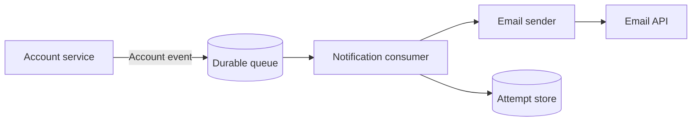

# Notification service: software architecture

## Overview

The notification service sends email notifications for account events. Callers submit events without waiting for email delivery. The service does not choose notification recipients.

## Requirement

### Functional

- Callers submit account events with an event ID, event type, recipient address, and timestamp, and the service rejects malformed events.
- Recipients receive an email for each valid account event, and callers can inspect the delivery outcome for each event.
- The service retries temporary email failures automatically and reports permanent rejections.

### Non-Functional

- Submitting the same event ID more than once sends at most one email to the recipient.
- Callers submit events without holding email provider credentials, and event payloads never expose secrets.
- Event bursts do not add latency to caller account requests, and operators receive an alert when pending deliveries grow.
- Duplicate and permanently rejected events do not trigger paid provider retries.

## Design

### Components and Responsibilities

- The account service publishes events and depends only on the event contract.
- The durable queue decouples email delivery from account requests and retries temporary failures.
- The consumer parses and deduplicates events before the sender submits mail to the provider.
- The attempt store records event IDs, delivery outcomes, and retry counts.

### Data and Control Flow

An account event enters the queue. The consumer parses the payload and queries the attempt store for the event ID before the sender calls the provider. The consumer records each attempt. The queue retries temporary failures, and the consumer reports permanent rejections. Synchronous delivery avoids the queue, but slow provider responses then delay account requests.

### Interfaces and Contracts

`AccountEvent` contains `id`, `type`, `recipient`, and `timestamp`. `handle(event)` processes the event, `send(message)` calls the provider, and `record(attempt)` saves the result. The event ID acts as the deduplication key. Provider credentials never enter the event payload.

## Implementation

### Consumer and storage

The notification service owns the consumer and attempt store. The account service imports only the event contract. Save the deduplication key with the delivery outcome so queue redelivery stays safe. Integration tests cover duplicate events and provider timeouts.

### Delivery operations

Keep provider credentials inside the notification service configuration. Alert operators when the queue grows or when provider calls fail repeatedly. If credentials leak, disable sending and drain pending work. Load tests cover event bursts so account request latency stays flat.

## References

- EX-34: example notification requirement.
