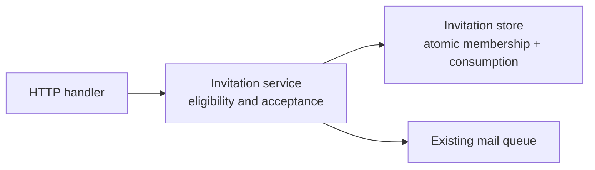
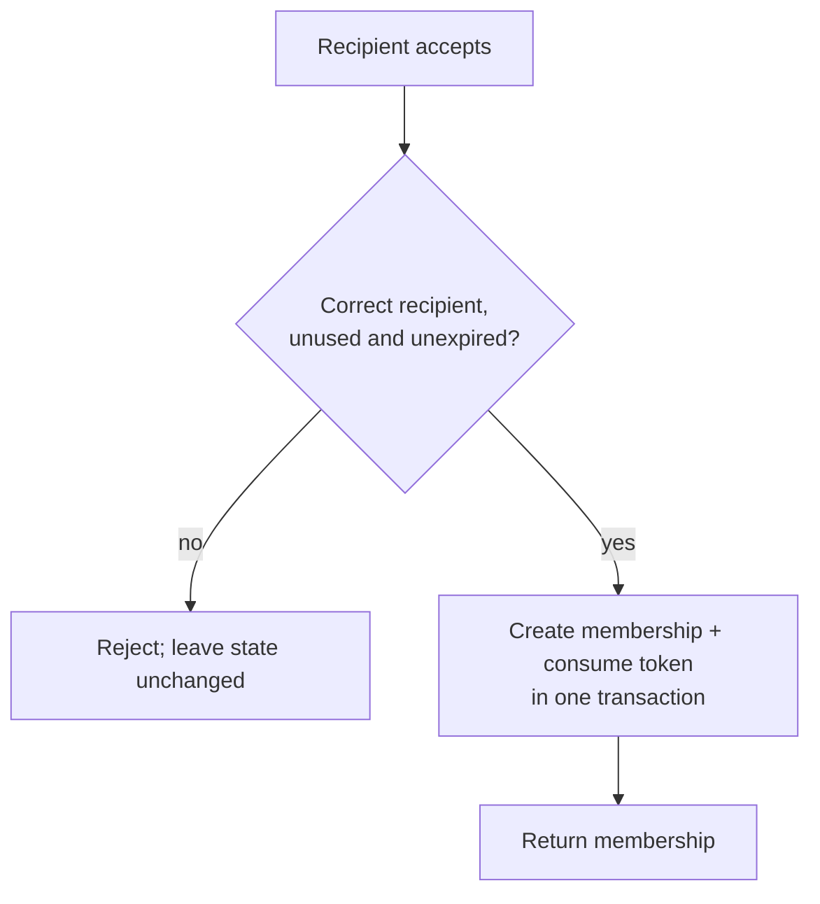

# Invite teammates to a project

- **Status:** draft
- **Branch:** feature/project-invites
- **Issue:** EX-12

## Intent

Project owners need to invite teammates without sharing credentials. Recipients should know which project they are joining before accepting.

## Requirements

- An owner can send an invite to a valid email address and see its pending state.
- Only the intended recipient can accept; expired or used invites fail without changing membership.
- Bulk invitations and organization-level roles are out of scope.

## Design

### Big Ideas

Keep invitation policy in the service and transport concerns in the handler. Store a single-use token hash, project, recipient, and expiry. Use the existing mail queue; no new service is needed.



Acceptance adds membership and consumes the invitation in one transaction. Invalid acceptance leaves both unchanged. Queue delivery after saving, so an email outage cannot lose an invitation.



### Infrastructure Changes

N/A.

### Interfaces

```text
POST /projects/:id/invitations      -> pending invitation (owner only)
POST /invitations/:token/accept     -> membership or safe rejection

createInvitation(project, email)   -> save token hash, then queue delivery
acceptInvitation(token, recipient) -> validate, then atomically consume + join
```

Never log raw tokens. Apply the existing request rate limit to creation; do not disclose another recipient's account details.

### Consequences

#### Repo Changes

Illustrative paths: `+` new, `~` changed, `*` largest edits. No files are removed.

```text
src/
├── invitations/
│   ├── store.ts               +   persistence and transaction
│   ├── service.ts             + * invitation policy
│   └── service.spec.ts        +   public API with real test store
└── http/
    ├── routes.ts              ~   register invitation handlers
    ├── invitations.ts         +   transport and authorization
    └── invitations.spec.ts    +   application request scenarios
```

#### Testing

```text
end-to-end/
└── invitation acceptance
    ├── owner sends invite -> recipient accepts -> membership appears
    └── wrong recipient, expired, or used token -> rejection; state unchanged
integration/
└── invitation service
    ├── failed transaction -> membership and token changes roll back
    └── email failure -> saved invitation stays pending for retry
```

Use request scenarios in `src/http/invitations.spec.ts` and service scenarios in `src/invitations/service.spec.ts`. Reuse fixtures with a real test store.

#### Trade-offs

Email delivery can fail after persistence. Use existing queue retries and keep the invitation pending. Resend, cancellation, and bulk invitations are deferred.

## Phases

### Phase 1: Persist and consume invitations

- [ ] Add a unique token hash, recipient email, project ID, expiry, and consumed timestamp to invitation storage in `src/invitations/store.ts`; never log raw tokens.
- [ ] Implement transactional membership creation and token consumption in `src/invitations/service.ts`; reject expired, used, or wrong-recipient tokens without a membership change.
- [ ] Exercise `createInvitation` and `acceptInvitation` through the service public API with the real test store in `src/invitations/service.spec.ts`. Verify rejection leaves membership and token state unchanged, including a failed transaction.
- [ ] Validation
  - [ ] Run the service contract scenarios; use grouped fixtures and clear Arrange/Act/Assert blocks.
  - [ ] Run relevant lint and format checks.

### Phase 2: Expose and deliver invitations

- [ ] Add owner creation and recipient acceptance handlers in `src/http/invitations.ts` with safe error responses and creation rate limits.
- [ ] Queue delivery after persistence, retry transient mail failures, and expose the pending state to owners.
- [ ] In `src/http/invitations.spec.ts`, send an owner invitation, accept as its recipient, and read back membership. Verify wrong-recipient, expired, and used-token requests leave state unchanged. Verify an email failure keeps the saved invitation pending.
- [ ] Validation
  - [ ] Run the end-to-end acceptance/rejection scenarios, then the service integration scenarios listed above.
  - [ ] Run relevant lint and format checks. This example grants no commit or push permission.
  - [ ] If execution authorizes commits and expects CI, commit the changes and confirm CI is green for that commit.

## References

- EX-12 — sample product request.
