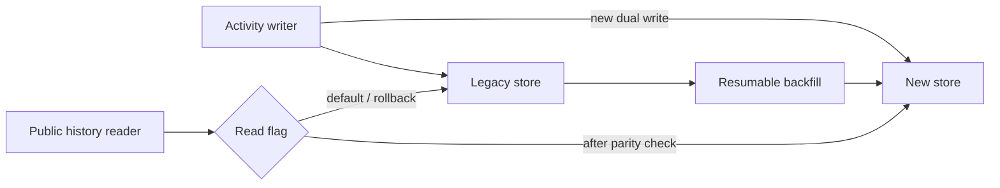
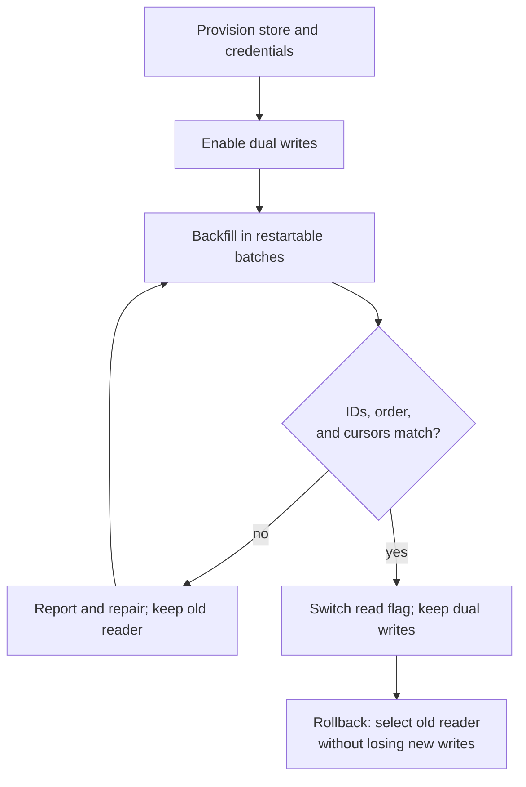

# Move activity history to a new store

- **Status:** draft
- **Branch:** feature/activity-migration
- **Issue:** EX-27

## Intent

Readers should retain access to historical activity while the team changes storage engines without downtime.

## Requirements

- Old and new records produce the same user-visible history, order, and cursors.
- Rollback can restore the prior reader without losing activity written during migration.
- No reader switches until backfill and comparison pass.

## Design

### Big Ideas

Write to both stores temporarily, backfill older records with stable IDs, compare counts and ordering, then switch readers behind a reversible flag. Keep the legacy reader authoritative until the new store is verified.



Stable IDs make retries safe. Track failed writes so comparison cannot silently treat missing data as a successful migration.



### Infrastructure Changes

Provision the new activity store and credentials before dual writes. Retain the legacy store and its capacity until the rollback window closes; monitor write failures for each store separately.

### Interfaces

```text
writeActivity(event)                 -> stable ID; retry failed destination writes
backfillActivity(projectId, cursor)  -> checkpoint + discrepancy report
listActivity(projectId, cursor)      -> same records, order, and cursor contract
readSource = legacy | new            # reversible; legacy remains default
```

### Consequences

#### Repo Changes

Illustrative paths: `+` new, `~` changed, `*` largest edits. No files are removed.

```text
infra/activity-store.tf          +   store, credentials, write-failure metrics
src/activity/
├── writer.ts                    ~ * dual writes and retries
├── backfill.ts                  + * resumable batches and comparison
├── reader.ts                    ~   reversible read source
├── migration.spec.ts            +   public API parity and restart scenarios
└── history.spec.ts              ~   application history across cutover/rollback
```

#### Trade-offs

Dual writes increase latency and allow partial failure. Record discrepancies and retry failed writes instead of hiding them. Removing the legacy store is outside this plan.

## Phases

### Phase 1: Provision and dual-write

- [ ] Provision the new store and credentials; add write-failure metrics for both stores.
- [ ] Make `src/activity/writer.ts` write idempotently to both stores with stable activity IDs while retaining the legacy reader.
- [ ] Exercise `writeActivity` against both test stores in `src/activity/migration.spec.ts`: retry a failed destination and verify one logical event in each store.
- [ ] Validation
  - [ ] Run public writer contract scenarios; confirm write-failure metrics are visible.
  - [ ] Run relevant lint and format checks.

### Phase 2: Backfill and compare

- [ ] Add resumable, idempotent batches in `src/activity/backfill.ts` without replacing newer dual-written records.
- [ ] Compare record IDs, counts, and ordering per project; report mismatches before any reader switch.
- [ ] Extend `migration.spec.ts` through `backfillActivity` and `listActivity`: interrupt and resume a batch, then verify IDs, ordering, and cursors match without duplicate or lost events.
- [ ] Validation
  - [ ] Run module public-API scenarios and review mismatch reports. Keep fixtures shared and Arrange/Act/Assert visible.
  - [ ] Run relevant lint and format checks.

### Phase 3: Switch reads with rollback

- [ ] Route `listActivity(projectId, cursor)` through a reversible flag in `src/activity/reader.ts` and preserve cursor compatibility.
- [ ] Extend application scenarios in `src/activity/history.spec.ts`: write and read paged history, switch stores, write again, and roll back. Assert the same visible history without lost events; do not assert private helper calls.
- [ ] Keep dual writes and monitor parity through the rollback window.
- [ ] Validation
  - [ ] Run application cutover/rollback scenarios first, then module contracts. Add focused public-API unit checks only for distinct logic not already verified.
  - [ ] Run relevant lint and format checks. This example grants no commit or push permission.

## References

- EX-27 — sample migration request.
