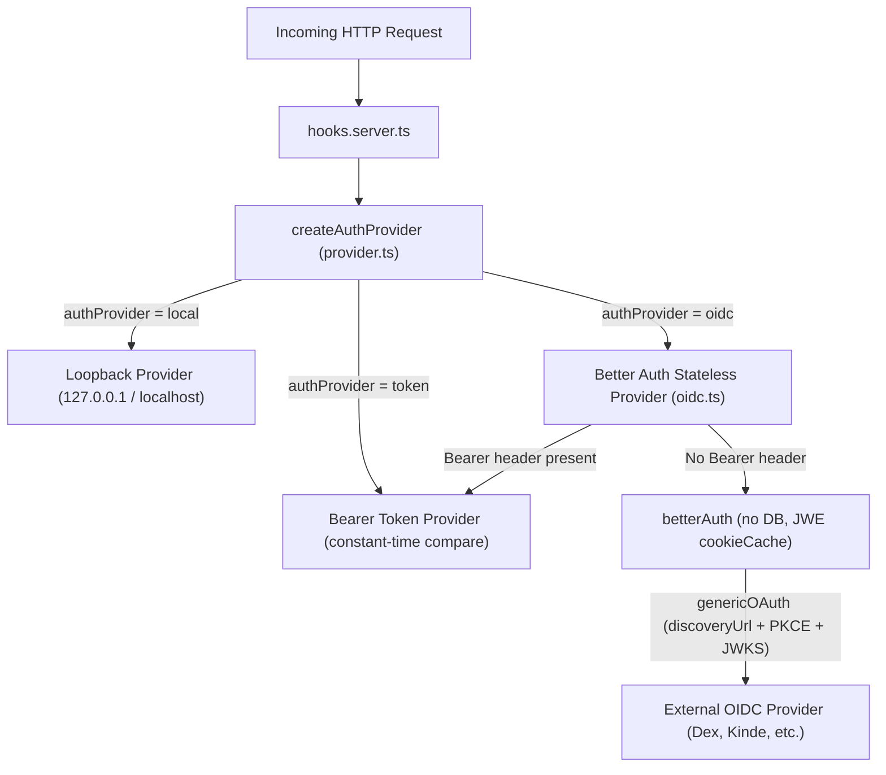
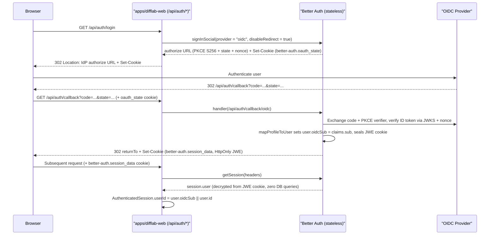

# Authentication: software architecture

## Overview

`apps/difflab-web` authenticates browser users and remote CLI clients through a single pluggable `AuthProvider` boundary under `apps/difflab-web/src/lib/server/auth/`. It supports three modes: loopback bypass for local `difflab ui` sessions, static bearer token authentication for remote CLI calls, and generic OpenID Connect (OIDC) powered by Better Auth in **stateless JWE cookie mode**. Running Better Auth without a database avoids coupling application auth to PostgreSQL schema migrations while keeping OIDC discovery, PKCE (S256), JWKS ID-token verification, and encrypted `HttpOnly` session cookies inside a maintained library.

## Requirement

### Functional

- Local `difflab ui` sessions on loopback (`127.0.0.1`, `localhost`, `::1`) work without accounts, cookies, or tokens.
- Hosted and self-hosted deployments authenticate browser users against any standard OIDC provider via `.well-known/openid-configuration` discovery without vendor-specific SDKs in this repository.
- Remote CLI clients authenticate with `Authorization: Bearer <token>` and `x-difflab-workspace` alongside OIDC browser sessions.
- External callback configuration stays stable at `/api/auth/callback` across local Docker, preview deployments, and production.

### Non-Functional

- Authentication must not require Better Auth to own or migrate tables in the application database (`libs/difflab-db` remains the sole database schema owner).
- Browser sessions must survive serverless cold starts and horizontal scaling with a deterministic user identifier across instances.
- Session and OAuth state cookies must stay well under the 4 KB browser cookie limit and carry `HttpOnly` and `SameSite=Lax` flags (`Secure` on HTTPS).

## Design

### Components and Responsibilities

- `apps/difflab-web/src/lib/server/auth/provider.ts` selects `local`, `token`, or `oidc` from `DifflabConfig` and layers CLI bearer token support ahead of browser cookies in `oidc` mode.
- `apps/difflab-web/src/lib/server/auth/oidc.ts` wraps Better Auth (`better-auth` + `genericOAuth` plugin) in stateless JWE cookie mode and adapts Difflab's stable `/api/auth/login`, `/api/auth/callback`, and `/api/auth/logout` routes.
- `apps/difflab-web/src/routes/api/auth/{login,callback,logout}/+server.ts` delegate directly to `runtime.authProvider` so route handlers stay independent of the underlying auth library.

### Data and Control Flow

## Implementation

### Better Auth Stateless Configuration

`createBetterAuthForOrigin` in `apps/difflab-web/src/lib/server/auth/oidc.ts` configures Better Auth with no `database` adapter:

- `session.cookieCache`: `{ enabled: true, maxAge: 604800, strategy: 'jwe', refreshCache: true }` stores the session payload in an encrypted `HttpOnly` JWE cookie (`better-auth.session_data`).
- `account.storeStateStrategy: 'cookie'` stores PKCE and CSRF state in an encrypted cookie (`better-auth.oauth_state`) instead of a database table.
- `account.storeAccountCookie: false` prevents Better Auth from serializing raw provider access and ID tokens into browser cookies.
- `plugins: [genericOAuth(...)]` discovers endpoints from `${OIDC_ISSUER_URL}/.well-known/openid-configuration`, enforces `pkce: true` and `requireIdTokenVerification: true` (JWKS + `nonce`), and sets `redirectURI` to `${origin}/api/auth/callback`.
- Instances are cached per external request origin (honoring `X-Forwarded-Proto` and `X-Forwarded-Host`) so ephemeral preview deployments work without hardcoding a single `BETTER_AUTH_URL`.

### Key Restrictions and Invariants

1. **Key user identity off OIDC `sub`, never Better Auth's ephemeral `user.id`:** Without a database, Better Auth generates a new random internal `user.id` on every sign-in. Difflab copies the verified OIDC `sub` claim into `user.additionalFields.oidcSub` inside `mapProfileToUser` and resolves `AuthenticatedSession.userId = oidcSub || session.user.id`. All application logic and database records must use `AuthenticatedSession.userId` (the stable OIDC `sub`).
2. **Do not enable `storeAccountCookie: true` without auditing cookie size:** Raw OIDC access and ID tokens from providers like Kinde or Auth0 can exceed the 4 KB browser cookie limit when encrypted into cookies. Because `storeAccountCookie` is `false`, server code cannot call Better Auth's `getAccessToken()` to invoke external IdP APIs on behalf of the user.
3. **Share `SESSION_SECRET` across all replicas and serverless functions:** Every instance must use the exact same `SESSION_SECRET` (at least 32 bytes) to decrypt `better-auth.session_data` and `better-auth.oauth_state`. Rotating `SESSION_SECRET` immediately invalidates all active browser sessions.
4. **No per-session server-side revocation:** Stateless JWE cookies remain valid until their 7-day `Max-Age` expires or the user hits `/api/auth/logout` (which clears the cookies with `Max-Age=0`). If immediate per-user revocation or server-side session listing is required later, migrate to a database-backed session store.
5. **Do not expose Better Auth's internal callback path externally:** External IdPs (Dex, Kinde, etc.) register `/api/auth/callback`. `handleCallback` rewrites `/api/auth/callback` to Better Auth's internal `/api/auth/callback/oidc` route so deployments stay decoupled from Better Auth's URL layout.

## References

- System architecture overview: [../index.md](../index.md)
- Deployment architecture (Vercel, self-hosted, and local): [../deployment.md](../deployment.md)
- Configuration architecture and OIDC environment variables: [../difflab-config/index.md](../difflab-config/index.md)
- Environment variables reference: [../../environment.md](../../environment.md)
