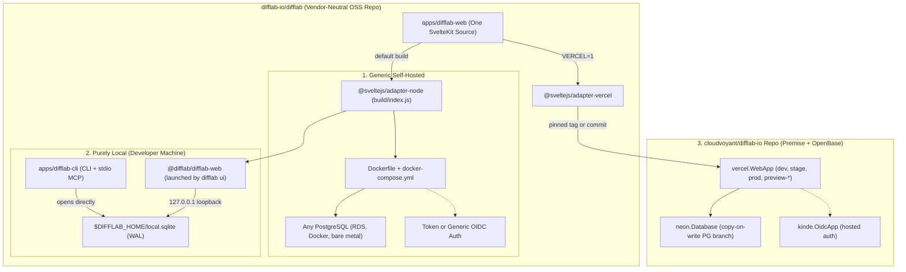
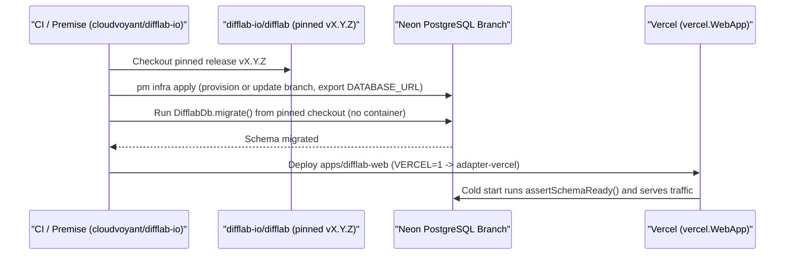
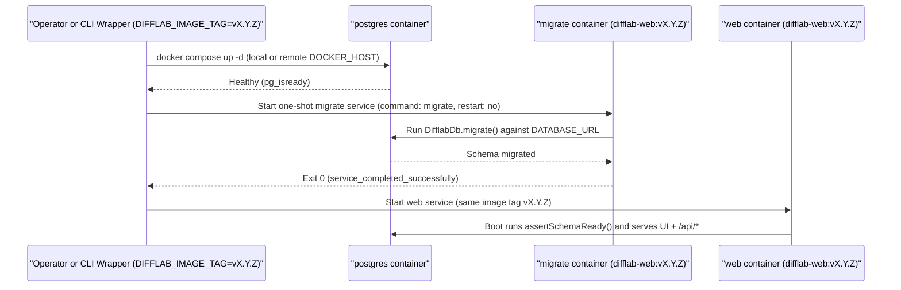
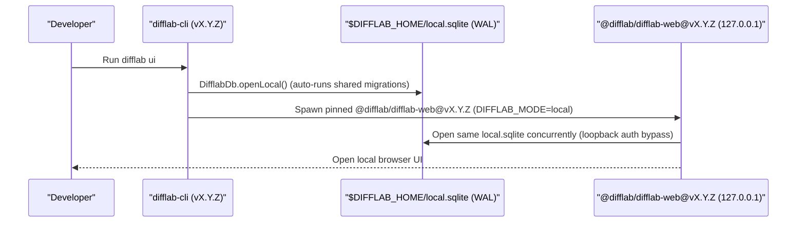
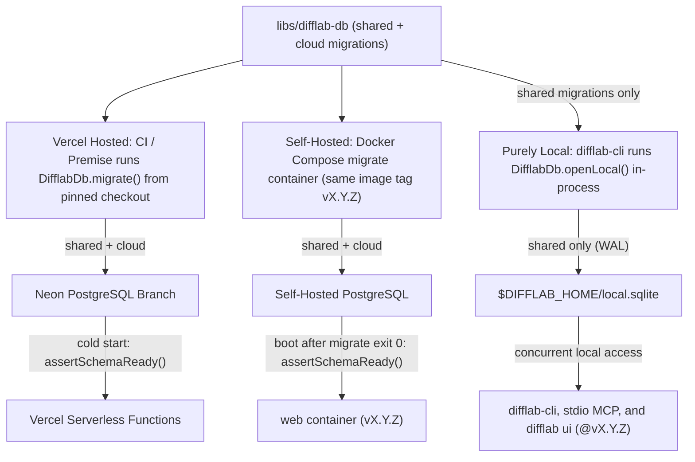

# Difflab Deployment: software architecture

## Overview

This document defines how Difflab builds, migrates, and runs across three deployment targets: generic self-hosted deployments with Docker Compose and PostgreSQL, purely local execution on a developer machine, and hosted cloud deployments on Vercel and Neon. This repository (`difflab-io/difflab`) owns the vendor-neutral application code, container build, Docker Compose setup, and local CLI packaging. A separate `cloudvoyant/difflab-io` repository owns the Premise Pulumi and OpenBase infrastructure stacks that deploy pinned releases of `apps/difflab-web` to Vercel. Managed Kubernetes manifests, GCP compute services, and automatic local-to-cloud database replication are out of scope.

## Requirement

### Functional

- Developers can start a local browser UI against their local workspace with one command and no external service setup.
- Self-hosters can deploy and run the full web application on their own infrastructure without accounts on any specific cloud vendor.
- Cloud operators can provision isolated development, staging, production, and pull-request preview environments from pinned application releases.
- Hosted and self-hosted deployments refuse traffic until required schema updates complete.

### Non-Functional

- Pull-request preview environments stay isolated from each other and from production data and secrets.
- Local browser sessions accept connections only from the local machine, start in seconds, and require no background system service.
- Self-hosted deployments integrate with the operator's own reverse proxy, database host, and identity provider.
- Hosted deployments run on on-demand compute and storage so idle environments incur minimal cost.

## Design

### Components and Responsibilities



- `apps/difflab-web` compiles to a standalone Node or Bun server (`build/index.js`) by default and to a Vercel serverless bundle when `VERCEL=1` is set.
- `apps/difflab-web/Dockerfile` and root `docker-compose.yml` in `difflab-io/difflab` package `build/index.js` and a migration entrypoint for generic self-hosting with zero cloud vendor dependencies.
- `apps/difflab-cli` runs local commands and stdio MCP directly against `local.sqlite` and starts `@difflab/difflab-web` on `127.0.0.1` when the user runs `difflab ui`.
- The separate `cloudvoyant/difflab-io` repository owns `infra/shared` and `infra/env` using Premise Pulumi and OpenBase (`vercel`, `neon`, and optional `kinde` components) and checks out `difflab-io/difflab` at a pinned release tag or commit.

### Data and Control Flow

Each target runs database migrations through a different runner, with zero Docker in Vercel hosted or purely local modes.

#### Hosted Cloud (Vercel and Neon, no Docker)



No Docker or Docker Compose runs in hosted cloud deployments. Premise and CI execute `DifflabDb.migrate()` directly from the pinned `difflab-io/difflab` checkout against Neon `DATABASE_URL` before `vercel.WebApp` publishes the new deployment alias.

#### Self-Hosted (Docker Compose, local or remote host)



In self-hosted deployments, `docker-compose.yml` runs the same published OCI image (`ghcr.io/difflab-io/difflab-web:${DIFFLAB_IMAGE_TAG}`) for both `migrate` and `web`. An optional CLI wrapper invokes the same `docker-compose.yml` locally or against a remote host over Docker contexts (`--context` or `DOCKER_HOST`), pinning `DIFFLAB_IMAGE_TAG` to the CLI release version.

#### Purely Local (`difflab ui`, no Docker or PostgreSQL)



Local mode uses no Docker and no PostgreSQL. `DifflabDb.openLocal` applies `shared` SQLite migrations in WAL mode, and `difflab ui` launches the exact matching `@difflab/difflab-web@<cliVersion>` package so the local CLI, stdio MCP, and local browser UI stay on the same schema version.

#### Migration Comparison Across Targets



### Interfaces and Contracts

#### Deployment Targets

| Dimension          | Vercel Hosted                                                                           | Generic Self-Hosted                                    | Purely Local (`difflab ui`)                     |
| :----------------- | :-------------------------------------------------------------------------------------- | :----------------------------------------------------- | :---------------------------------------------- |
| SvelteKit adapter  | `@sveltejs/adapter-vercel`                                                              | `@sveltejs/adapter-node`                               | `@sveltejs/adapter-node`                        |
| Artifact           | Vercel serverless bundle                                                                | OCI image (`ghcr.io/difflab-io/difflab-web:<version>`) | `@difflab/difflab-web@<cliVersion>` npm package |
| Database           | Neon PostgreSQL (`neon.Database`)                                                       | Any PostgreSQL 15+                                     | `$DIFFLAB_HOME/local.sqlite` (WAL)              |
| Migration trigger  | `mise run //apps/difflab-web:migrate <env>`                                             | One-shot `migrate` service in `docker-compose.yml`     | Automatic on `DifflabDb.openLocal`              |
| UI authentication  | Generic OIDC (`DIFFLAB_AUTH_PROVIDER=oidc`, wired to Kinde in `cloudvoyant/difflab-io`) | Generic OIDC or static token                           | Loopback bypass (`DIFFLAB_MODE=local`)          |
| CLI authentication | Bearer token + `x-difflab-workspace`                                                    | Bearer token + `x-difflab-workspace`                   | Direct SQLite (no HTTP)                         |

#### Environment Variables

| Environment Variable                                                        | Modes               | Purpose                                                                                                                                            |
| :-------------------------------------------------------------------------- | :------------------ | :------------------------------------------------------------------------------------------------------------------------------------------------- |
| `DIFFLAB_MODE`                                                              | All                 | Selects `local` (SQLite, loopback bypass) or `cloud` (PostgreSQL, auth required). Defaults to `cloud` when `DATABASE_URL` is set.                  |
| `DATABASE_URL`                                                              | Hosted, self-hosted | PostgreSQL connection string (`postgres://...`). Required when `DIFFLAB_MODE=cloud`.                                                               |
| `DIFFLAB_HOME`                                                              | Local               | Local state directory for `local.sqlite`, `templates/`, and `projects/`. Defaults to `~/.difflab`.                                                 |
| `DIFFLAB_AUTH_PROVIDER`                                                     | Hosted, self-hosted | Selects `oidc` (generic OIDC issuer), `token` (shared secret only), or `local` (loopback bypass).                                                  |
| `OIDC_ISSUER_URL`, `OIDC_CLIENT_ID`, `OIDC_CLIENT_SECRET`, `SESSION_SECRET` | Hosted, self-hosted | Generic OIDC discovery, PKCE client credentials, and session cookie encryption key required when `DIFFLAB_AUTH_PROVIDER=oidc`.                     |
| `DIFFLAB_API_TOKEN`                                                         | Hosted, self-hosted | Bearer secret for remote `difflab-cli` calls to `/api/*`.                                                                                          |
| `DIFFLAB_IMAGE_TAG`                                                         | Self-hosted         | OCI image tag used by both `migrate` and `web` services in `docker-compose.yml`. Defaults to the CLI version when invoked through the CLI wrapper. |
| `HOST` and `PORT`                                                           | Self-hosted, local  | Bind address and port for `build/index.js`. Local mode forces `127.0.0.1` and defaults `PORT` to `0` (ephemeral free port).                        |
| `VERCEL`                                                                    | Hosted build        | Set automatically during Vercel builds to switch `svelte.config.js` to `@sveltejs/adapter-vercel`.                                                 |

## Implementation

### Build Adapter Selection

`apps/difflab-web/svelte.config.js` selects the adapter with one environment condition:

```js
import adapterNode from '@sveltejs/adapter-node'
import adapterVercel from '@sveltejs/adapter-vercel'

const adapter = process.env.VERCEL ? adapterVercel() : adapterNode()
```

No route or server module imports adapter-specific APIs. All HTTP handlers use standard Web Request and Response objects so the same code runs on Vercel serverless functions, Docker containers, and local Node or Bun processes.

### Hosted Cloud Provisioning (`cloudvoyant/difflab-io`)

The separate `cloudvoyant/difflab-io` repository keeps all organization-specific infrastructure out of `difflab-io/difflab`. Its `premise.yaml` sets `workspace.infra.shared_directory: infra/shared` and `workspace.infra.directory: infra/env`, and both Go programs import `github.com/cloudvoyant/openbase/libs/components`:

- `cloudvoyant/difflab-io` pins a release tag or commit of `difflab-io/difflab` (as a Git submodule or CI checkout) so each environment (`dev`, `stage`, `prod`, `preview-<slug>`) promotes a known release.
- `infra/shared/main.go` calls `openbase.LookupPlatform(ctx)` once and creates `vercel.NewProject("web")`, `neon.NewProject("db")`, and optional `kinde.NewProject("auth")`.
- `infra/env/main.go` calls `openbase.LookupShared(ctx)` and creates `neon.NewDatabase("db")` (branching `stage` from `prod` and `preview-*` from `dev`), optional `kinde.NewOidcApp("auth")`, and `vercel.NewWebApp("web")` with `SourceDir` pointing to the pinned `apps/difflab-web` directory.
- `vercel.NewWebApp` injects `DATABASE_URL` and auth secrets per stack through `Secrets`. Preview stacks (`preview-<slug>`) pass branch secrets through `DeploymentArgs.Environment` so concurrent pull requests never overwrite each other.
- Before each deployment, the `cloudvoyant/difflab-io` `migrate` task runs `libs/difflab-db` migrations from the pinned checkout against the stack `DATABASE_URL`.

### Generic Self-Hosting and Image Publishing

A multi-stage `apps/difflab-web/Dockerfile` (built with monorepo root context `.`) builds `apps/difflab-web` with `adapter-node` and produces a minimal runtime image containing `build/` and `libs/difflab-db` migrations with two entrypoints: the default web server (`build/index.js`) and `migrate` (`DifflabDb.migrate()`). Release workflows publish multi-architecture OCI images to GitHub Container Registry (`ghcr.io/difflab-io/difflab-web:<version>` and `latest`), while local contributors can still build directly from `apps/difflab-web/Dockerfile`.

A companion `docker-compose.yml` pairs `postgres` (with a `pg_isready` health check), a one-shot `migrate` service (`restart: "no"`), and the `web` service (`depends_on: migrate` with `service_completed_successfully`). Both `migrate` and `web` reference `ghcr.io/difflab-io/difflab-web:${DIFFLAB_IMAGE_TAG}` so upgrades via `docker compose pull && docker compose up -d` or a CLI Docker-context wrapper always run matching migrations before starting the web server.

Authentication sits behind a small provider interface in `apps/difflab-web/src/lib/server/auth/`: `oidc` for any standard OIDC provider (Keycloak, Authentik, Okta, Dex, or Kinde wired via `OIDC_*` variables in `cloudvoyant/difflab-io`), `token` for single-team setups, and `local` for loopback sessions. `difflab-io/difflab` carries zero vendor-specific auth SDKs or credentials.

### Purely Local Execution and SQLite Isolation

Running `difflab ui` from `@difflab/difflab-cli` starts the exact matching `@difflab/difflab-web@<cliVersion>` package (pinned to `PREMISE_PACKAGE_VERSION`) on `127.0.0.1` with `DIFFLAB_MODE=local` and the active `DIFFLAB_HOME`. Launching `@difflab/difflab-web` on demand keeps `@difflab/difflab-cli` small for CLI-only users while preventing SQLite schema skew between the CLI and local UI.

Inside `libs/difflab-db`, the SQLite driver (`kysely-bun-worker` and `bun:sqlite`) must load lazily through dynamic `import()` only when the SQLite dialect is selected. This makes sure that Vercel Node serverless bundles never attempt to resolve `bun:sqlite` at build or startup time.

## References

- System architecture overview: [./index.md](./index.md)
- Dual-dialect database architecture: [./difflab-db/index.md](./difflab-db/index.md)
- Configuration architecture: [./difflab-config/index.md](./difflab-config/index.md)
- Environment variables and state layout: [../environment.md](../environment.md)
- OpenBase user guide: `github.com/cloudvoyant/openbase/docs/user-guide.md`
- OpenBase Vercel WebApp architecture: `github.com/cloudvoyant/openbase/docs/architecture/providers/vercel/web-app.md`
