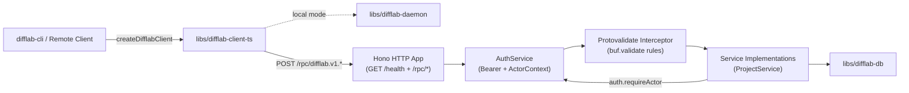
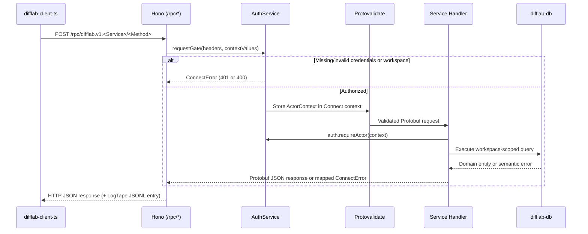

# Difflab API: software architecture

## Overview

`difflab-api` is Difflab's HTTP RPC server for project and Git remote metadata. It serves the same Connect JSON-RPC (an HTTP JSON RPC protocol generated from Protocol Buffers) API in two deployment modes: a single-owner local background daemon over SQLite for `difflab-cli` and `stdio` MCP sessions, and a multi-tenant cloud service over PostgreSQL for remote CLI and web clients. Local filesystem workflows (templates, todo lists, progress logs, and `.difflab` symlinks), OAuth token issuance, and background local-to-cloud sync are out of scope.

## Requirement

### Functional

- Clients query a `/health` endpoint to verify server readiness before sending RPC traffic.
- Local callers on loopback invoke RPC methods without credentials and read or write records in the local workspace.
- First-time local startup initializes the local database automatically and imports existing `v0.13.0` projects once without modifying the legacy database file.
- Cloud callers authenticate with a Bearer API token and select a target workspace on every RPC call.
- Invalid request fields return HTTP `400` (`invalid_argument`), missing or invalid Bearer credentials return HTTP `401` (`unauthenticated`), missing cloud workspace headers return HTTP `400` (`invalid_argument`), unknown resources return HTTP `404` (`not_found`), and conflicting keys or remote links return HTTP `409` (`already_exists`).

### Non-Functional

- Startup fails before binding a TCP port if cloud credentials are missing or if an existing database has unapplied schema migrations, preventing partial or unauthenticated traffic.
- Bearer token verification runs in constant time so response latency does not leak token prefixes or length.
- Every RPC call emits a single-line structured JSON log containing the method path, HTTP status, workspace, request body, and response body for operator and E2E inspection.
- Local mode binds to loopback by default and carries zero external infrastructure cost, while cloud mode runs statelessly over pooled PostgreSQL connections.

## Design

### Components and Responsibilities



- `apps/difflab-api/proto/` owns the `.proto` schemas and `buf.validate` field rules, generating server descriptors into `apps/difflab-api/src/gen/` and client descriptors into private `libs/difflab-client-ts/src/gen/`.
- `apps/difflab-api/src/dtos/` defines Protobuf contract DTOs (`ProjectDTO`, `GitRemoteDTO`) grouping `schema`, `toProto`, and `fromProto` conversions.
- `apps/difflab-api/src/services/auth-service.ts` (`AuthService`) validates cloud startup credentials, enforces constant-time Bearer token checks and `x-difflab-workspace` headers in `requestGate`, and tracks per-request authenticated `ActorContext` (`currentActor`) via `AsyncLocalStorage`.
- `apps/difflab-api/src/app.ts` binds Hono typed context variables (`c.var`), wraps Connect handlers at `/rpc/*`, and emits one canonical wide-event JSONL record per RPC call via `runWithWideEvent` (`libs/utils/logx`, supporting multiple LogTape sinks).
- `apps/difflab-api/src/server.ts` composes `AuthService`, `DifflabDb.open`, and `ProjectRpcService`, binds `Bun.serve`, and manages local `daemon.json` lifecycle via `DifflabDaemon`.

### Data and Control Flow



### Interfaces and Contracts

```ts
export type AuthService = {
  mode: ApiMode
  requestGate: (req: UniversalServerRequest, contextValues: ContextValues) => void
  requireActor: (context: HandlerContext) => ActorContext
}

export type AppDeps = {
  db: DifflabDb
  auth?: AuthService
  mode?: ApiMode
  apiToken?: string
  log?: (entry: Record<string, unknown>) => void
}

export function createApp(deps: AppDeps): Hono
```

| Endpoint / Header | Mode | Contract |
| --- | --- | --- |
| `GET /health` | `local`, `cloud` | Returns `200 OK` with `{ "ok": true, "mode": "<mode>" }`. |
| `POST /rpc/<package>.<Service>/<Method>` | `local`, `cloud` | Connect JSON-RPC unary endpoint. See [projects.md](./projects.md) for `ProjectService` methods. |
| `Authorization: Bearer <token>` | `cloud` | Required; compared against `DIFFLAB_API_TOKEN`. |
| `x-difflab-workspace: <id>` | `cloud` | Required non-empty workspace identifier (`1..64` chars). |

## Implementation

### Code Generation and Private SDK Boundary

`apps/difflab-api/buf.gen.yaml` runs `@bufbuild/protoc-gen-es` twice so server handlers and `libs/difflab-client-ts` stay in lockstep from one `.proto` source. `mise run //apps/difflab-api:lint` runs `codegen:check` to reject stale generated files in CI. `libs/difflab-client-ts` owns `createDifflabClient` with zero daemon dependencies, keeps `"private": true` without `publishConfig`, and is bundled directly into `@difflab/difflab-cli`.

### Startup Modes, Migrations, and Daemon Metadata

`apps/difflab-api/src/server.ts` loads configuration via `DifflabConfig.load()` (`cloud` mode when `DIFFLAB_MODE=cloud` or `DATABASE_URL` is set, and `local` mode otherwise). In `local` mode, `DifflabDb.openLocal` auto-creates and migrates `$DIFFLAB_HOME/local.sqlite` on first boot, `Bun.serve` binds `127.0.0.1:<port>`, and `DifflabDaemon.writeMetadata` writes `$DIFFLAB_HOME/daemon.json` atomically. In `cloud` mode, PostgreSQL migrations run ahead of deployment through Premise's `[tasks.migrate]` task in `apps/difflab-api/mise.toml`, and server startup asserts schema readiness without auto-migrating.

## References

- `ProjectService` RPC contracts and error mapping: [projects.md](./projects.md)
- Dual-dialect persistence architecture: [../difflab-db/index.md](../difflab-db/index.md)
- Environment variables and migration workflow: [../../environment.md](../../environment.md) and [../../development.md](../../development.md)
- Connect Protocol specification: <https://connectrpc.com/docs/protocol/>
