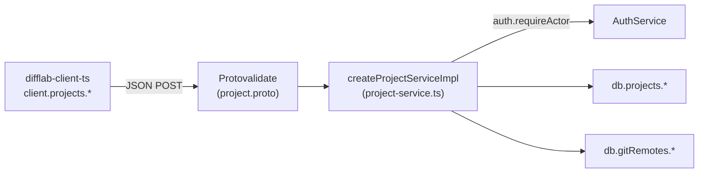

# ProjectService API: software architecture

## Overview

`difflab.v1.ProjectService` exposes project creation, listing, lookup, and Git remote linking over Connect JSON-RPC. It serves remote `difflab project`, `difflab init`, and `project_context` operations (when `DIFFLAB_RPC_URL` is set) as well as cloud web clients. Local CLI and `stdio` MCP sessions read and write `local.sqlite` directly via `libs/difflab-db`; local `.difflab` directory creation and `difflab.yaml` files remain client-side responsibilities in `apps/difflab-cli` and `libs/difflab-config`.

## Requirement

### Functional

- Clients can create a project with a unique key, display name, and optional set of Git remote URLs, and retrieve or list projects belonging to their workspace.
- Clients can pass Git remote URLs in SSH, SCP, or HTTPS format and receive a single canonical representation across all operations.
- Clients can link a Git remote to an existing project idempotently when it already belongs to that project, while attempts to link a remote owned by another project in the same workspace are rejected without modifying existing links.

### Non-Functional

- Malformed requests are rejected immediately at the API boundary with clear, categorized errors before touching persisted state.
- Multi-remote project creation succeeds or fails atomically so clients never observe partially created projects.
- Every read and write is strictly isolated to the caller's workspace with consistent low latency across local and hosted deployments.

## Design

### Components and Responsibilities



- `apps/difflab-api/proto/difflab/v1/project.proto` defines `ProjectService`, message schemas, and `buf.validate` constraints.
- `apps/difflab-api/src/dtos/project.ts` and `apps/difflab-api/src/dtos/git-remote.ts` define `ProjectDTO` and `GitRemoteDTO` (`DTO` mappers from `utils/dto` with `schema`, `toProto`, and `fromProto`).
- `apps/difflab-api/src/services/project-service.ts` (`ProjectRpcService`) resolves the caller's `ActorContext` via injected `AuthService`, invokes `libs/difflab-db` queries (`db.projects` and `db.gitRemotes`), maps domain entities through `ProjectDTO` and `GitRemoteDTO`, and translates domain exceptions to Connect status codes.

### Data and Control Flow

1. Protovalidate checks `key` / `project_key` against `^[A-Za-z][A-Za-z0-9]{2,15}$`, `name` length (`1..100`), and non-empty URL strings.
2. `createProjectServiceImpl` calls `auth.requireActor(context)` to obtain `{ workspaceId, userId }`.
3. `libs/difflab-db` canonicalizes Git URLs, enforces workspace-scoped uniqueness inside a transaction, and returns Zod-validated domain entities (`Project` and `GitRemote`).
4. Domain exceptions translate to Connect errors: `ProjectValidationError` -> `InvalidArgument` (`400`), `ProjectNotFoundError` -> `NotFound` (`404`), and `ProjectConflictError` -> `AlreadyExists` (`409`).

### Interfaces and Contracts

```protobuf
service ProjectService {
  rpc CreateProject(CreateProjectRequest) returns (CreateProjectResponse);
  rpc ListProjects(ListProjectsRequest) returns (ListProjectsResponse);
  rpc GetProject(GetProjectRequest) returns (GetProjectResponse);
  rpc LinkRepository(LinkRepositoryRequest) returns (LinkRepositoryResponse);
}
```

| RPC Method | Request Fields | Success Response | Error Codes |
| --- | --- | --- | --- |
| `CreateProject` | `key`, `name`, `repository_urls[]` | `CreateProjectResponse { project }` | `400`, `401`, `409` |
| `ListProjects` | `{}` | `ListProjectsResponse { projects[] }` | `400`, `401` |
| `GetProject` | `key` | `GetProjectResponse { project }` | `400`, `401`, `404` |
| `LinkRepository` | `project_key`, `remote_url` | `LinkRepositoryResponse { repository }` | `400`, `401`, `404`, `409` |

```ts
// Usage via libs/difflab-client-ts
const client = createDifflabClient({
  mode: 'remote',
  rpcUrl: 'https://api.difflab.io/rpc',
  token: process.env.DIFFLAB_API_TOKEN,
  workspaceId: 'ws-acme',
})

const { project } = await client.projects.createProject({
  key: 'DIFFLAB',
  name: 'Difflab',
  repositoryUrls: ['git@github.com:difflab-io/difflab.git'],
})
```

## Implementation

### Protobuf Field Mapping

`ProjectDTO` and `GitRemoteDTO` own all Protobuf-to-model mapping at the API boundary so `libs/difflab-db` stays focused on Kysely models (`Project`, `GitRemote`) without wire-format concerns.

## References

- API server overview and `AuthService`: [index.md](./index.md)
- Protobuf schema: `apps/difflab-api/proto/difflab/v1/project.proto`
- Database project and Git remote queries: [../difflab-db/projects.md](../difflab-db/projects.md)
