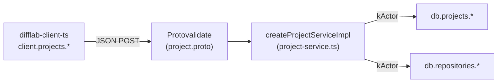

# ProjectService API: software architecture

## Overview

`difflab.v1.ProjectService` exposes project creation, listing, lookup, and Git repository linking over Connect JSON-RPC. It serves `difflab project`, `difflab init`, and the `project_context` MCP tool across local daemons and remote cloud workspaces. Local `.difflab` directory creation and `difflab.yaml` files remain client-side responsibilities in `apps/difflab-cli`.

## Requirement

### Functional

- Callers create a project with a 3-to-16 character alphanumeric key starting with a letter, a display name up to 100 characters, and zero or more Git remote URLs.
- Project keys normalize to uppercase and Git SSH, SCP, and HTTPS remote URLs normalize to canonical `https://<host>/<path>` URLs with deterministic slugs.
- Callers list all projects in the active workspace in alphabetical key order or fetch one project by key with its linked repositories.
- Callers link a Git remote URL to an existing project idempotently when the URL already belongs to that project, and receive `409 already_exists` if the URL belongs to another project in the same workspace.

### Non-Functional

- Request schema validation rejects malformed project keys, blank names, and empty repository URLs at the RPC boundary before hitting the database.
- All project and repository reads and writes are isolated to the caller's resolved workspace (`local` in local mode or `x-difflab-workspace` in cloud mode).
- Multi-repository project creation executes atomically so a conflicting URL rolls back the project insert cleanly.

## Design

### Components and Responsibilities



- `apps/difflab-api/proto/difflab/v1/project.proto` defines `ProjectService`, message schemas, and `buf.validate` constraints.
- `apps/difflab-api/src/services/project-service.ts` reads the `ActorContext` from `kActor`, invokes `libs/difflab-db` queries, converts domain records to Protobuf messages, and maps domain exceptions to Connect status codes.

### Data and Control Flow

1. Protovalidate checks `key` / `project_key` against `^[A-Za-z][A-Za-z0-9]{2,15}$`, `name` length (`1..100`), and non-empty URL strings.
2. `createProjectServiceImpl` extracts `{ workspaceId, userId }` from `context.values.get(kActor)`.
3. `libs/difflab-db` canonicalizes Git URLs, enforces workspace-scoped uniqueness inside a transaction, and returns normalized domain models.
4. Domain exceptions translate to Connect errors: `ProjectValidationError` -> `InvalidArgument` (`400`), `ProjectNotFoundError` -> `NotFound` (`404`), and `ProjectConflictError` -> `AlreadyExists` (`409`).

### Interfaces and Contracts

```protobuf
service ProjectService {
  rpc CreateProject(CreateProjectRequest) returns (CreateProjectResponse);
  rpc ListProjects(ListProjectsRequest) returns (ListProjectsResponse);
  rpc GetProject(GetProjectRequest) returns (GetProjectResponse);
  rpc LinkRepository(LinkRepositoryRequest) returns (LinkRepositoryResponse);
}
```

| RPC Method | Request Fields | Success Response | Error Codes |
| --- | --- | --- | --- |
| `CreateProject` | `key`, `name`, `repository_urls[]` | `CreateProjectResponse { project }` | `400`, `401`, `409` |
| `ListProjects` | `{}` | `ListProjectsResponse { projects[] }` | `400`, `401` |
| `GetProject` | `key` | `GetProjectResponse { project }` | `400`, `401`, `404` |
| `LinkRepository` | `project_key`, `remote_url` | `LinkRepositoryResponse { repository }` | `400`, `401`, `404`, `409` |

```ts
// Usage via libs/difflab-client-ts
const client = createDifflabClient({
  mode: 'remote',
  rpcUrl: 'https://api.difflab.io/rpc',
  token: process.env.DIFFLAB_API_TOKEN,
  workspaceId: 'ws-acme',
})

const { project } = await client.projects.createProject({
  key: 'DIFFLAB',
  name: 'Difflab',
  repositoryUrls: ['git@github.com:difflab-io/difflab.git'],
})
```

## Implementation

### Protobuf Field Mapping

Domain `Project.id` maps to Protobuf `Project.key`, and domain `Repository.url` maps to Protobuf `Repository.remote_url` (`remoteUrl` in TypeScript) so wire contracts support non-GitHub hosts without legacy `github_url` naming.

## References

- API server overview and auth gate: [index.md](./index.md)
- Protobuf schema: `apps/difflab-api/proto/difflab/v1/project.proto`
- Database project and repository queries: [../difflab-db/projects.md](../difflab-db/projects.md)
