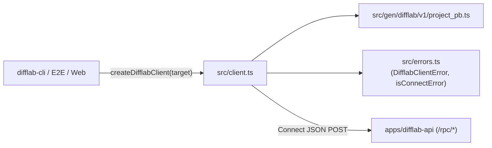

# Difflab TypeScript Client: software architecture

## Overview

`libs/difflab-client-ts` is Difflab's private Connect JSON-RPC TypeScript client library. It wraps generated Protocol Buffer service descriptors with target validation and optional remote authentication headers so `difflab-cli`, tests, and future TypeScript consumers call `difflab-api` with end-to-end static typing. Process lifecycle and environment variable discovery remain outside this library.

## Requirement

### Functional

- Callers construct a typed client for either a local loopback endpoint or a remote authenticated endpoint with optional Bearer token and workspace headers.
- Invalid RPC URLs and non-loopback local targets fail immediately before sending any network request.
- Callers inspect server RPC failures using canonical Connect status codes to distinguish invalid requests, authentication failures, missing resources, conflicts, and internal server errors.

### Non-Functional

- Generated client descriptors stay synchronized with `apps/difflab-api` Protocol Buffer definitions through automated CI checks.
- The client library carries zero runtime dependency on server or database packages so it can be reused in both CLI and web contexts.

## Design

### Components and Responsibilities



- `src/client.ts` exports `createDifflabClient` and its colocated target, transport, and client types.
- `src/errors.ts` defines `DifflabClientError`, `DifflabClientConfigError`, and `isConnectError(error, code?)`.
- `src/gen/` contains generated Protobuf descriptors emitted by `mise run //apps/difflab-api:codegen`.
- `src/index.ts` re-exports the public client factory, generated types, `ConnectError`, and `Code`.

### Data and Control Flow

1. `createDifflabClient(target, transportOptions)` parses `target.rpcUrl` and enforces loopback hosts when `target.mode === 'local'`.
2. For `target.mode === 'remote'`, a Connect interceptor attaches `Authorization: Bearer <token>` and `x-difflab-workspace` when provided and not already overridden on the request.
3. Calls execute over `createConnectTransport` (`useBinaryFormat: false`), returning typed Protobuf messages or throwing `ConnectError` with a canonical `Code`.

### Interfaces and Contracts

```ts
export type DifflabClientTarget =
  | { mode: 'local'; rpcUrl: string }
  | { mode: 'remote'; rpcUrl: string; token?: string; workspaceId?: string }

export function createDifflabClient(
  target: DifflabClientTarget,
  transportOptions?: DifflabTransportOptions,
): DifflabClient

export function isConnectError(error: unknown, code?: Code): error is ConnectError
```

## Implementation

### Connect Error Model and Private Workspace Packaging

Following Connect and gRPC conventions, server errors propagate as `ConnectError` carrying a canonical `Code` (`InvalidArgument` = `400`, `Unauthenticated` = `401`, `NotFound` = `404`, `AlreadyExists` = `409`, `Internal` = `500`), while `DifflabClientConfigError` covers only pre-flight client configuration errors. The package remains `"private": true` without `publishConfig` and is bundled directly into `@difflab/difflab-cli`.

## References

- Server RPC architecture and codegen: [../difflab-api/index.md](../difflab-api/index.md)
- `ProjectService` contracts: [../difflab-api/projects.md](../difflab-api/projects.md)
