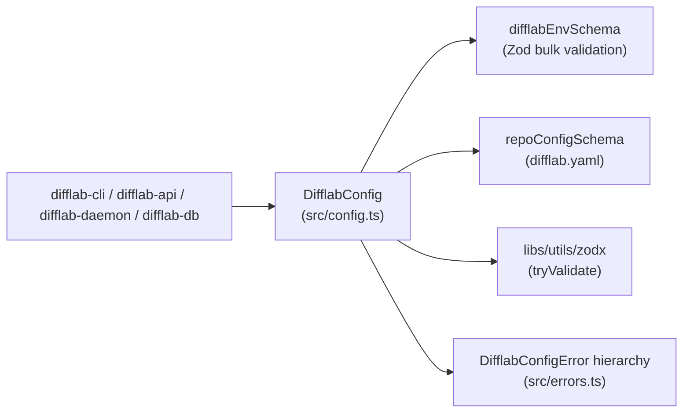

# Difflab Config: software architecture

## Overview

`libs/difflab-config` is Difflab's shared configuration and path resolution library. It validates environment variables, state directory layouts, TCP port values, project keys, and repository-local `difflab.yaml` manifests in one place for `difflab-cli`, `difflab-api`, `difflab-daemon`, and `difflab-db`. Remote secret stores and interactive configuration prompts are out of scope.

## Requirement

### Functional

- Callers load typed runtime settings from environment variables and receive all validation failures together in one error rather than failing on one field at a time.
- Callers resolve consistent local state paths (database, legacy database, daemon metadata, daemon logs, templates, and project stores) from an explicit directory, a user home directory, or default user state.
- Callers read and atomically create repository-local `difflab.yaml` files while rejecting malformed YAML, unknown keys, or non-canonical project keys before any database lookup.

### Non-Functional

- All configuration validation failures raise a predictable package-scoped exception hierarchy so callers can distinguish missing manifests from invalid configuration.
- Creating a repository manifest fails cleanly without overwriting an existing file when concurrent initializers race.

## Design

### Components and Responsibilities



- `src/config.ts` defines `DifflabConfig`, `difflabEnvSchema`, `repoConfigSchema`, `portSchema`, `projectKeySchema`, and all colocated configuration types.
- `src/errors.ts` defines `DifflabConfigError` as the base exception class with `MissingRepoConfig` and `InvalidRepoConfig` subclasses.
- `src/index.ts` re-exports the public API without implementation code.

### Data and Control Flow

1. `DifflabConfig.load({ home, root, env })` parses `env` through `difflabEnvSchema` using `tryValidate` from `libs/utils/zodx`, collecting every schema issue into one `DifflabConfigError`.
2. Root resolution applies precedence `explicit root` -> `home/.difflab` -> `DIFFLAB_HOME` -> `~/.difflab` and derives every child path deterministically.
3. `DifflabConfig.readRepo(dir)` parses `difflab.yaml` with `yaml` and validates it against `repoConfigSchema` (`z.strictObject`), returning `null` on `ENOENT`.

### Interfaces and Contracts

```ts
export class DifflabConfig {
  readonly mode: ApiMode
  readonly paths: DifflabPaths
  readonly host: string
  readonly port: number
  readonly databaseUrl?: string
  readonly apiToken?: string
  readonly apiEntry?: string
  readonly remote: RemoteRpcConfig | null

  static load(options?: DifflabConfigLoadOptions): DifflabConfig
  static fromRoot(root: string, env?: NodeJS.ProcessEnv): DifflabConfig
  static resolvePaths(home?: string, env?: NodeJS.ProcessEnv): DifflabPaths
  static parsePort(raw: string | number): number
  static validateProjectKey(raw: string): string
  static readRepo(dir: string): Promise<RepoConfig | null>
  static writeRepo(config: RepoConfig, dir: string): Promise<string>
}
```

## Implementation

### Single-Pass Zod Validation

`difflabEnvSchema` and `repoConfigSchema` share `tryValidate` from `libs/utils/zodx` so both environment configuration and `difflab.yaml` report all invalid keys in one semicolon-separated message without bespoke per-field parsers.

## References

- Environment variable reference: [../../environment.md](../../environment.md)
- Daemon lifecycle consumer: [../difflab-daemon/index.md](../difflab-daemon/index.md)
- Database consumer: [../difflab-db/index.md](../difflab-db/index.md)
