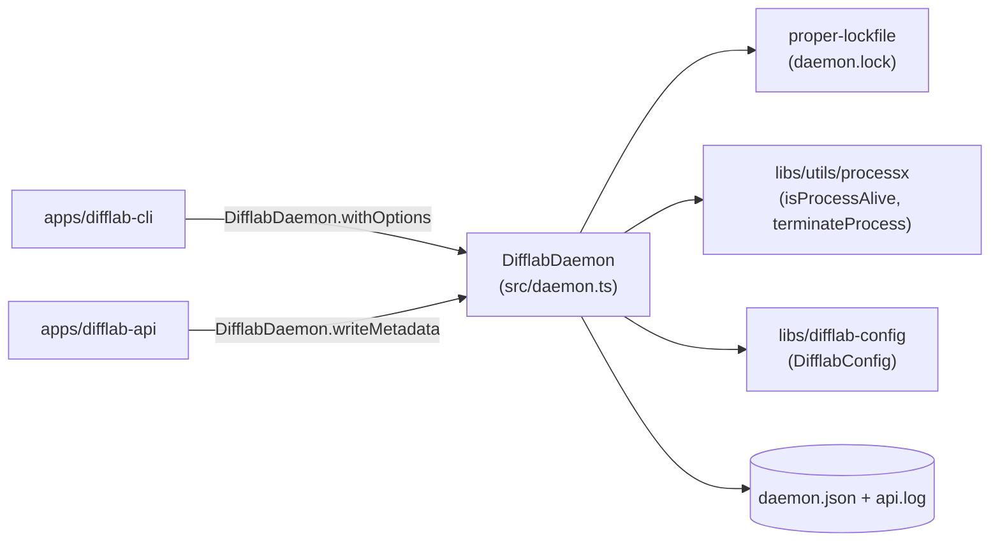
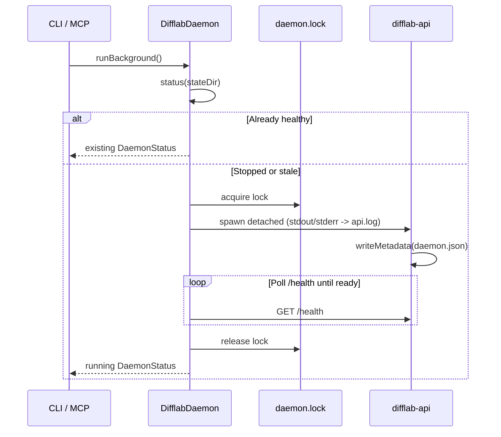

# Difflab Daemon: software architecture

## Overview

`libs/difflab-daemon` manages the lifecycle of the local background `difflab-api` server for `difflab-cli` and `stdio` MCP sessions. It handles exclusive state-directory locking, detached or foreground process startup, health probing, atomic metadata persistence, and graceful shutdown. Remote cloud deployments and RPC request transport are out of scope.

## Requirement

### Functional

- Callers start the local server either in the foreground (forwarding termination signals) or detached in the background, reusing an already healthy server instead of spawning duplicates.
- Callers inspect whether the local server is currently healthy and retrieve its process ID, HTTP URL, and RPC URL.
- Callers stop a running server cleanly and receive an idempotent no-op result when no server is running.

### Non-Functional

- Concurrent callers racing to start the local server serialize safely so at most one background server owns a state directory at a time.
- State directories and metadata files that are symbolic links or non-regular files are rejected before locking or writing.
- Crashed or stale server processes are detected via liveness and health checks and cleaned up automatically on restart.

## Design

### Components and Responsibilities



- `src/daemon.ts` exports `DifflabDaemon` with static helpers (`withOptions`, `metadataPath`, `resolveApiEntry`, `writeMetadata`, `status`, `stop`) and instance methods (`run`, `runForeground`, `runBackground`, `status`, `stop`), plus colocated types.
- `src/errors.ts` defines `DifflabDaemonError` as the base exception class with `DaemonLifecycleError`.
- `src/daemon.spec.ts` verifies detached startup, concurrent reuse, status probing, and graceful stop against a real HTTP server script.

### Data and Control Flow



### Interfaces and Contracts

```ts
export class DifflabDaemon {
  static withOptions(options: DifflabDaemonOptions): DifflabDaemon
  static metadataPath(stateDir: string): string
  static resolveApiEntry(explicitEntry?: string): string
  static writeMetadata(stateDir: string, record: DaemonRecord): Promise<void>
  static status(stateDir: string): Promise<DaemonStatus>
  static stop(stateDir: string, timeoutMs?: number): Promise<{ stopped: boolean; pid?: number }>

  withOptions(overrides: Partial<DifflabDaemonOptions>): DifflabDaemon
  run(runOptions?: {
    foreground?: boolean
  }): Promise<Extract<DaemonStatus, { running: true }> | null>
  runForeground(): Promise<void>
  runBackground(): Promise<Extract<DaemonStatus, { running: true }>>
  status(): Promise<DaemonStatus>
  stop(timeoutMs?: number): Promise<{ stopped: boolean; pid?: number }>
}
```

## Implementation

### Process Liveness, Atomic Metadata, and LogTape Logging

Process probing (`isProcessAlive`, treating `EPERM` as alive) and graceful SIGTERM-to-SIGKILL termination (`terminateProcess`) live in `libs/utils/processx`, while polling uses `Bun.sleep`. `writeMetadata` writes to a PID/UUID-suffixed temporary file with `0o600` permissions before atomically renaming onto `daemon.json`, and `readDaemonRecord` validates parsed JSON with Zod.

## References

- Configuration and state paths: [../difflab-config/index.md](../difflab-config/index.md)
- API server metadata writer: [../difflab-api/index.md](../difflab-api/index.md)
