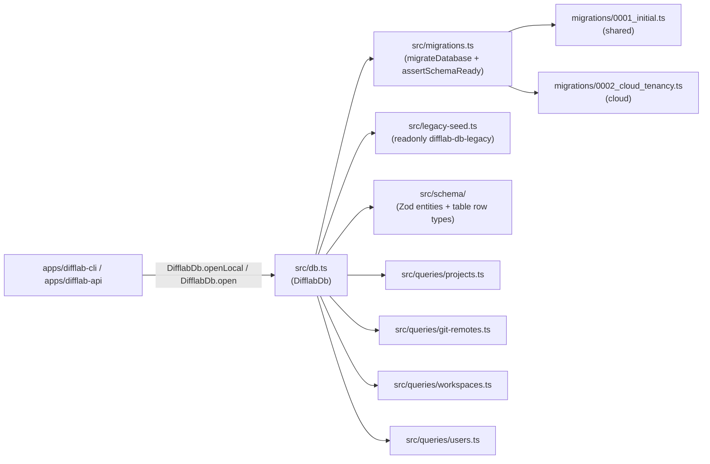
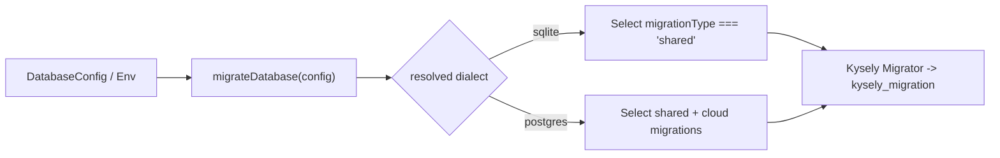
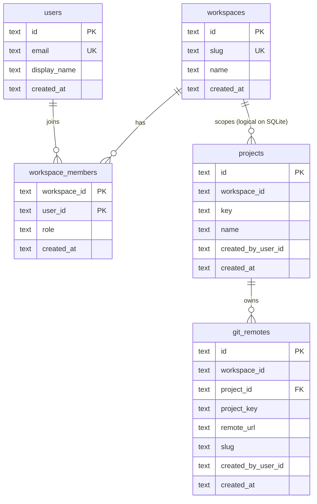

# Difflab DB: software architecture

## Overview

`libs/difflab-db` is Difflab's greenfield dual-dialect persistence library built on Kysely (a type-safe TypeScript SQL query builder) and Zod entity schemas. It backs `difflab-api` over local SQLite (`$DIFFLAB_HOME/local.sqlite` via `bun:sqlite`) and cloud PostgreSQL (`pg.Pool`). Legacy `v0.13.0` SQLite access stays frozen in `libs/difflab-db-legacy` (`difflab.sqlite`) and is encapsulated inside `openLocalDifflabDb` so installed `v0.13.0` and current CLI or MCP binaries coexist on the same machine without in-place schema changes.

## Requirement

### Functional

- Clients can persist and query projects and Git remotes identically against local single-user storage or hosted multi-tenant storage.
- First-time local users seamlessly inherit existing `v0.13.0` projects without modifying or breaking their legacy database file.
- Uninitialized or out-of-date databases fail fast on open without creating partial state, while databases migrated by newer versions remain readable.

### Non-Functional

- Local CLI and MCP sessions open the database in milliseconds and tolerate concurrent local readers and writers without a background server.
- Hosted deployments isolate tenant data strictly and serialize concurrent schema migrations safely without data corruption.

## Design

### Components and Responsibilities



- `src/index.ts` is a pure re-export barrel; types are colocated with the modules that own them (`db.ts`, `migrations.ts`, `schema/`).
- `src/db.ts` exports the `DifflabDb` class (`DifflabDb.open`, `DifflabDb.openLocal`, `DifflabDb.fromConfig`, `DifflabDb.connect`, `DifflabDb.migrate`, `DifflabDb.resolveConfig`) plus `isUniqueConstraintError`.
- `src/schema/` (`common.ts`, `project.ts`, `git-remote.ts`, `user.ts`, `workspace.ts`) defines Zod table models via `defineModel(...)` (`utils/model`: `ProjectModel`, `GitRemoteModel`, `UserModel`, `WorkspaceModel`, `WorkspaceMemberModel`), mapped directly to Kysely tables via `CamelCasePlugin` with zero row-to-entity translation layers.
- `src/migrations.ts` holds `ALL_MIGRATIONS` from top-level `libs/difflab-db/migrations/`, filters by `migrationType: 'shared' | 'cloud'`, and verifies schema readiness; `mise run //libs/difflab-db:migrate` invokes `DifflabDb.migrate()` directly without a bespoke CLI script.
- `src/queries/` groups thin query modules for `projects`, `git-remotes`, `workspaces`, and `users`.

### Data and Control Flow



When `DifflabDb.fromConfig(config)` runs, `DifflabDb.connect` opens the dialect without creating missing SQLite files and calls `assertSchemaReady`, which inspects `kysely_migration` read-only without constructing a `Migrator` (preventing accidental table creation on unmigrated files). For local CLI commands, `stdio` MCP sessions, and local `difflab-api` startup, `DifflabDb.openLocal` creates `$DIFFLAB_HOME/local.sqlite` only when missing, runs shared migrations, and imports sibling `difflab.sqlite` once via internal `src/legacy-seed.ts`.

### Interfaces and Contracts



```ts
export type MigrationType = 'shared' | 'cloud'
export type ActorContext = { workspaceId: string; userId: string | null }

export type DatabaseConfig =
  { dialect: 'sqlite'; path: string } | { dialect: 'postgres'; connectionString: string }

export function connect(config?: DatabaseConfig, options?: ConnectSqliteOptions): ConnectedDatabase
export function migrateDatabase(config?: DatabaseConfig): Promise<string[]>
export function createDifflabDb(config?: DatabaseConfig): Promise<DifflabDb>
export function openLocalDifflabDb(options: LocalDatabaseOptions): Promise<DifflabDb>
```

## Implementation

### Compile-Time Migration Type Safety and Standalone Embedding

`defineSharedMigration` types `up` and `down` against `Kysely<CoreDatabase>` (`projects` and `git_remotes` only), preventing shared SQLite migrations from referencing cloud-only tables at compile time. `defineCloudMigration` types against `Kysely<DifflabDatabase>` (`CoreDatabase & CloudDatabase`). Numbered migrations live at `libs/difflab-db/migrations/` outside `src/` following conventional layout while being statically imported by `src/migrations.ts` so `bun build` embeds them in standalone local bundles and runs them identically against remote PostgreSQL in CI.

### Encapsulated Legacy Seeding

`src/legacy-seed.ts` keeps `libs/difflab-db-legacy` hidden inside `libs/difflab-db` so `apps/difflab-api` and `apps/difflab-cli` have zero direct imports from the legacy v1 store.

### Dual-Dialect Testing with Wire-Protocol PGlite

`src/db.spec.ts` runs dual-dialect migration, workspace-isolation, and PostgreSQL tenancy contracts against both `bun:sqlite` and a real PostgreSQL wire socket backed by `@electric-sql/pglite` + `@electric-sql/pglite-socket`, exercising `pg.Pool` without Docker or test-only branches in `src/db.ts`.

## References

- Project and Git remote queries and indexes: [projects.md](./projects.md)
- Cloud workspace, user, and membership queries and RLS: [workspaces-and-users.md](./workspaces-and-users.md)
- API consumer architecture: [../difflab-api/index.md](../difflab-api/index.md)
