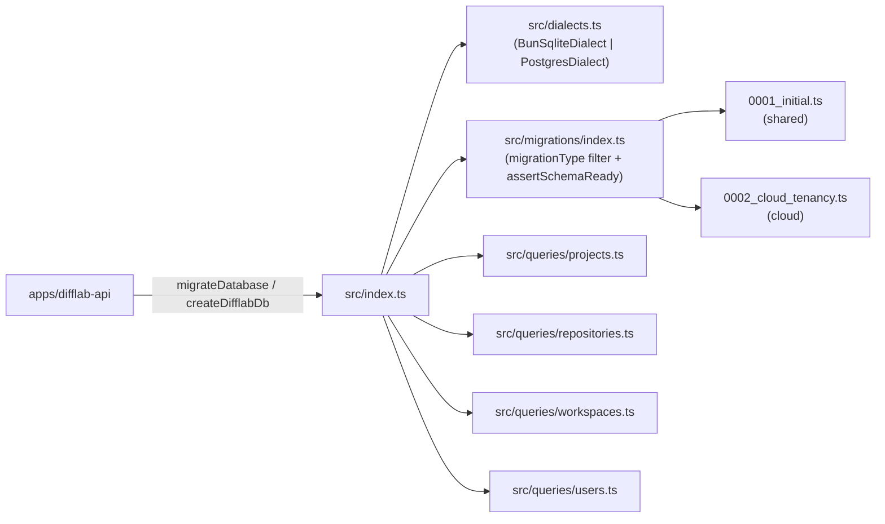
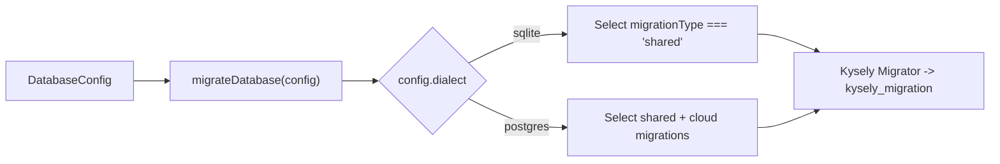

# Difflab DB: software architecture

## Overview

`libs/difflab-db` is Difflab's greenfield dual-dialect persistence library built on Kysely (a type-safe TypeScript SQL query builder). It backs `difflab-api` over local SQLite (`$DIFFLAB_HOME/local.sqlite` via `bun:sqlite`) and cloud PostgreSQL (`pg.Pool`). Legacy `v0.13.0` SQLite access stays frozen in `libs/difflab-db-legacy` (`difflab.sqlite`) so installed `v0.13.0` and current CLI or MCP binaries coexist on the same machine without in-place schema changes.

## Requirement

### Functional

- Callers run migrations explicitly against either a SQLite file path or a PostgreSQL connection string before opening a database handle.
- SQLite databases apply only shared migrations, while PostgreSQL databases apply both shared and cloud tenancy migrations in chronological order.
- Opening an unmigrated or partially migrated database fails immediately without creating tables or sidecar files.
- Opening a database whose migration history includes newer unknown migrations succeeds as long as all known applicable migrations are present.

### Non-Functional

- Local SQLite runs in write-ahead logging (WAL) mode with foreign keys enabled under a single local daemon owner, avoiding multi-process lock retry loops.
- PostgreSQL migrations serialize automatically with Kysely's advisory lock and enable row-level security (RLS) policies on workspace-scoped tables.
- Production database configuration accepts only a SQLite file path or a PostgreSQL connection string; embedded test engines never leak into production exports.

## Design

### Components and Responsibilities



- `src/dialects.ts` opens `BunSqliteDialect` (configuring `WAL`, `foreign_keys = ON`, and `busy_timeout = 5000`) or `PostgresDialect` over `pg.Pool`, and normalizes SQLite and PostgreSQL (`23505`) unique-constraint errors.
- `src/migrations/` stores a single chronological migration list tagged with `migrationType: 'shared' | 'cloud'`.
- `src/queries/` groups thin domain query modules for projects, repositories, workspaces, and users.

### Data and Control Flow



When `createDifflabDb(config)` runs, it opens the dialect without creating missing SQLite files and calls `assertSchemaReady`, which inspects `kysely_migration` read-only without constructing a `Migrator` (preventing accidental table creation on unmigrated files).

### Interfaces and Contracts


```ts
export type MigrationType = 'shared' | 'cloud'
export type ActorContext = { workspaceId: string; userId: string | null }

export type DatabaseConfig =
  { dialect: 'sqlite'; path: string } | { dialect: 'postgres'; connectionString: string }

export function migrateDatabase(config: DatabaseConfig): Promise<string[]>
export function createDifflabDb(config: DatabaseConfig): Promise<DifflabDb>
```

## Implementation

### Compile-Time Migration Type Safety

`defineSharedMigration` types `up` and `down` against `Kysely<CoreDatabase>` (`projects` and `repositories` only), preventing shared SQLite migrations from referencing cloud-only tables at compile time. `defineCloudMigration` types against `Kysely<DifflabDatabase>` (`CoreDatabase & CloudDatabase`).

### Coexistence with `libs/difflab-db-legacy`

`libs/difflab-db` writes `$DIFFLAB_HOME/local.sqlite` and has zero dependency on `libs/difflab-db-legacy`. One-shot import from `$DIFFLAB_HOME/difflab.sqlite` lives in `apps/difflab-api/src/legacy-seed.ts` so removing v1 support later only deletes `libs/difflab-db-legacy` and `legacy-seed.ts`.

### Dual-Dialect Testing with Wire-Protocol PGlite

`src/index.test.ts` runs every shared behavior against both `bun:sqlite` and a real PostgreSQL wire socket backed by `@electric-sql/pglite` + `@electric-sql/pglite-socket`, exercising `pg.Pool` and PostgreSQL RLS without Docker or test-only branches in `src/dialects.ts`.

## References

- Project and repository queries and indexes: [projects.md](./projects.md)
- Cloud workspace, user, and membership queries and RLS: [workspaces-and-users.md](./workspaces-and-users.md)
- API consumer architecture: [../difflab-api/index.md](../difflab-api/index.md)
