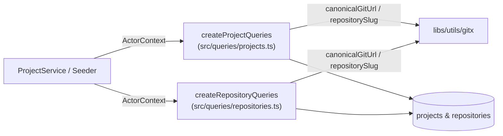

# Difflab DB Projects and Repositories: software architecture

## Overview

The `projects` and `repositories` query modules in `libs/difflab-db` store workspace-scoped project definitions and canonical Git remote links across SQLite and PostgreSQL. Every operation runs in the context of an `ActorContext` (`workspaceId` and optional `userId`).

## Requirement

### Functional

- Callers create projects with normalized uppercase keys (`3..16` alphanumeric characters starting with a letter), trimmed names (`1..100` characters), and optional initial Git remote URLs.
- Callers list projects in ascending key order or fetch a single project by key together with its ordered repository links.
- Linking a Git remote URL already attached to the same project returns the existing repository record idempotently.
- Duplicate project keys, duplicate initial remote URLs, or remote URLs already linked to a different project in the same workspace fail with `ProjectConflictError`, while identical keys and URLs across different workspaces succeed independently.

### Non-Functional

- Project creation and initial repository inserts execute in one database transaction so partial failures leave zero orphan rows.
- Workspace-scoped composite unique indexes enforce key, URL, and slug uniqueness inside the database engine under concurrent requests.

## Design

### Components and Responsibilities



- `src/queries/projects.ts` validates keys, workspace IDs, and project names, and executes transactional `createProject`, `listProjects`, and `getProjectById` queries.
- `src/queries/repositories.ts` executes idempotent `linkRepositoryToProject` upserts (`ON CONFLICT (workspace_id, github_url) DO NOTHING` followed by ownership verification).

### Data and Control Flow

When `linkRepositoryToProject(projectKey, origin, actor)` runs:

1. Normalize `workspaceId`, uppercase `projectKey`, and canonicalize `origin` via `canonicalGitUrl`.
2. Look up `(workspace_id, key)` inside a transaction; throw `ProjectNotFoundError` if absent.
3. Insert the candidate repository with `ON CONFLICT (workspace_id, github_url) DO NOTHING`.
4. Select the row for `(workspace_id, github_url)`: if `project_id` matches the target project, return it; otherwise throw `ProjectConflictError`.

### Interfaces and Contracts

```ts
export type Repository = {
  id: string
  projectId: string
  url: string
  slug: string
  createdAt: string
}

export type Project = {
  id: string
  name: string
  workspaceId: string
  createdByUserId: string | null
  createdAt: string
  repositories: Repository[]
}
```

| Index Name | Columns | Purpose |
| --- | --- | --- |
| `projects_workspace_key_unique` | `(workspace_id, key)` | Enforces unique project keys per workspace and accelerates `getProjectById` and `listProjects`. |
| `repositories_workspace_url_unique` | `(workspace_id, github_url)` | Prevents linking one canonical remote URL to two projects in the same workspace and backs idempotent conflict handling. |
| `repositories_workspace_project_slug_unique` | `(workspace_id, project_id, slug)` | Guarantees collision-free `.difflab/projects/<KEY>/<slug>` directory slugs within a project. |

## Implementation

### Cross-Dialect Timestamp and UUID Generation

`projects` and `repositories` generate UUID primary keys via `node:crypto` `randomUUID()` and ISO-8601 UTC timestamps in application code so SQLite and PostgreSQL share identical column types (`text`) without dialect-specific default expressions.

## References

- Dual-dialect database overview and ERD: [index.md](./index.md)
- Shared schema migration: `libs/difflab-db/src/migrations/0001_initial.ts`
- `ProjectService` RPC consumer: [../difflab-api/projects.md](../difflab-api/projects.md)
