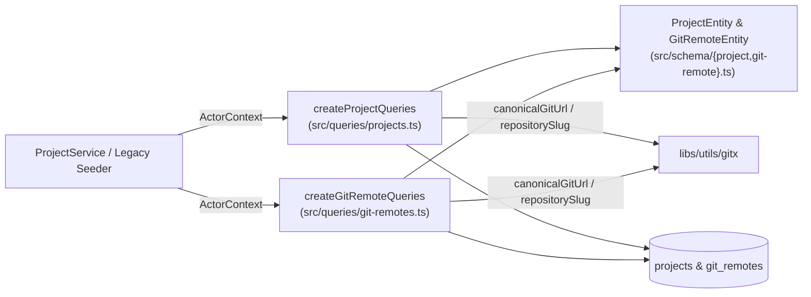

# Difflab DB Projects and Git Remotes: software architecture

## Overview

The `projects` and `git-remotes` query modules and Zod entity schemas in `libs/difflab-db` store workspace-scoped project definitions and canonical Git remote links across SQLite and PostgreSQL. Every operation runs in the context of an `ActorContext` (`workspaceId` and optional `userId`).

## Requirement

### Functional

- Callers create projects with normalized uppercase keys (`3..16` alphanumeric characters starting with a letter), trimmed names (`1..100` characters), and optional initial Git remote URLs.
- Callers list projects in ascending key order or fetch a single project by key together with its ordered Git remote links.
- Linking a Git remote URL already attached to the same project returns the existing remote record idempotently.
- Duplicate project keys, duplicate initial remote URLs, or remote URLs already linked to a different project in the same workspace are rejected as conflicts, while identical keys and URLs across different workspaces succeed independently.

### Non-Functional

- Project creation and initial Git remote links succeed or roll back atomically so failed calls leave zero partial state.
- Concurrent requests within a workspace cannot create duplicate project keys, duplicate remote URL links, or colliding remote slugs.

## Design

### Components and Responsibilities



- `src/schema/project.ts` and `src/schema/git-remote.ts` define Zod schemas, row types, validators, and `fromRow` mappers on `ProjectEntity` and `GitRemoteEntity`.
- `src/queries/projects.ts` executes transactional `createProject`, `listProjects`, and `getProjectById` queries.
- `src/queries/git-remotes.ts` executes idempotent `linkGitRemoteToProject` upserts (`ON CONFLICT (workspace_id, remote_url) DO NOTHING` followed by ownership verification).

### Data and Control Flow

When `linkGitRemoteToProject(projectKey, origin, actor)` runs:

1. Normalize `workspaceId`, uppercase `projectKey` via `ProjectEntity.normalizeKey`, and canonicalize `origin` via `canonicalGitUrl`.
2. Look up `(workspace_id, key)` inside a transaction; throw `ProjectNotFoundError` if absent.
3. Insert the candidate remote row with `ON CONFLICT (workspace_id, remote_url) DO NOTHING`.
4. Select the row for `(workspace_id, remote_url)`: if `project_id` matches the target project, return `GitRemoteEntity.fromRow(row)`; otherwise throw `ProjectConflictError`.

### Interfaces and Contracts

```ts
export type GitRemote = {
  id: string
  projectId: string
  url: string
  slug: string
  createdAt: string
}

export type Project = {
  id: string
  name: string
  workspaceId: string
  createdByUserId: string | null
  createdAt: string
  gitRemotes: GitRemote[]
}
```

| Index Name | Columns | Purpose |
| --- | --- | --- |
| `projects_workspace_key_unique` | `(workspace_id, key)` | Enforces unique project keys per workspace and accelerates `getProjectById` and `listProjects`. |
| `git_remotes_workspace_url_unique` | `(workspace_id, remote_url)` | Prevents linking one canonical remote URL to two projects in the same workspace and backs idempotent conflict handling. |
| `git_remotes_workspace_project_slug_unique` | `(workspace_id, project_id, slug)` | Guarantees collision-free `.difflab/projects/<KEY>/<slug>` directory slugs within a project. |

## Implementation

### Cross-Dialect Timestamp and UUID Generation

`projects` and `git_remotes` generate UUID primary keys via `node:crypto` `randomUUID()` and ISO-8601 UTC timestamps in application code so SQLite and PostgreSQL share identical column types (`text`) without dialect-specific default expressions.

## References

- Dual-dialect database overview and ERD: [index.md](./index.md)
- Shared schema migration: `libs/difflab-db/migrations/0001_initial.ts`
- `ProjectService` RPC consumer: [../difflab-api/projects.md](../difflab-api/projects.md)
