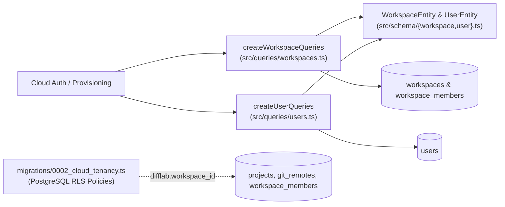

# Difflab DB Workspaces and Users: software architecture

## Overview

The `workspaces` and `users` query modules, Zod entity schemas (`WorkspaceEntity`, `WorkspaceMemberEntity`, and `UserEntity`), and the `0002_cloud_tenancy` cloud migration provide tenant identity, user directory records, role-based workspace membership, and PostgreSQL row-level security (RLS) for cloud deployments. These tables exist only on PostgreSQL and are never created on local SQLite.

## Requirement

### Functional

- Cloud services create and fetch workspaces by ID or lowercase URL-safe slug (`2..48` characters) and manage `owner`, `admin`, and `member` memberships.
- Updating an existing workspace member's role keeps their original membership join timestamp unchanged.
- Cloud services upsert users by normalized lowercase email address, updating their display name on repeat sign-in while preserving their stable user identity and creation timestamp.

### Non-Functional

- Database-enforced tenant isolation restricts non-superuser queries on projects, Git remotes, and memberships to the active workspace.
- Concurrent user sign-ins and workspace creation calls never create duplicate accounts for the same email or duplicate workspaces for the same slug.

## Design

### Components and Responsibilities



- `migrations/0002_cloud_tenancy.ts` (`migrationType: 'cloud'`) creates `workspaces`, `users`, and `workspace_members` and enables PostgreSQL RLS policies.
- `src/schema/workspace.ts` and `src/schema/user.ts` colocated entity objects (`WorkspaceEntity`, `WorkspaceMemberEntity`, and `UserEntity`) validate slugs, roles, emails, and display names and map database rows to typed domain records.
- `src/queries/workspaces.ts` exposes `createWorkspace`, `getWorkspaceById`, `getWorkspaceBySlug`, `upsertMember`, and `listMembers`.
- `src/queries/users.ts` exposes `upsertUserByEmail` and `getUserById`.

### Data and Control Flow

1. `upsertUserByEmail` normalizes the email via `UserEntity.normalizeEmail`, validates `displayName` via `UserEntity.validateDisplayName`, inserts the candidate row, and updates `display_name` via `ON CONFLICT (email) DO UPDATE` before returning `UserEntity.fromRow(row)`.
2. `upsertMember` validates `role` (`owner | admin | member`) via `WorkspaceMemberEntity.validateRole`, inserts into `workspace_members`, and updates `role` on `(workspace_id, user_id)` conflict without touching `created_at`.

### Interfaces and Contracts

```ts
export type WorkspaceRole = 'owner' | 'admin' | 'member'

export type Workspace = {
  id: string
  slug: string
  name: string
  createdAt: string
}

export type User = {
  id: string
  email: string
  displayName: string
  createdAt: string
}

export type WorkspaceMember = {
  workspaceId: string
  userId: string
  role: WorkspaceRole
  createdAt: string
}
```

| Constraint / Policy | Target | Rule |
| --- | --- | --- |
| `workspaces.slug` unique | `workspaces` | Lowercase alphanumeric + hyphen slug (`^[a-z0-9][a-z0-9-]{1,47}$`). |
| `users.email` unique | `users` | Normalized lowercase email address. |
| `workspace_members_pk` | `workspace_members` | Primary key `(workspace_id, user_id)` with cascading foreign keys to `workspaces` and `users`. |
| `*_workspace_isolation` RLS | `projects`, `git_remotes`, `workspace_members` | `USING` and `WITH CHECK` require `workspace_id = current_setting('difflab.workspace_id', true)`. |

## Implementation

### Defense-in-Depth Tenant Isolation

Query modules always filter explicitly by `.where('workspace_id', '=', workspaceId)` on both SQLite and PostgreSQL, while PostgreSQL RLS policies in `migrations/0002_cloud_tenancy.ts` add database-enforced tenant isolation whenever sessions bind `SET LOCAL difflab.workspace_id`.

## References

- Dual-dialect database overview and ERD: [index.md](./index.md)
- Cloud tenancy migration: `libs/difflab-db/migrations/0002_cloud_tenancy.ts`
