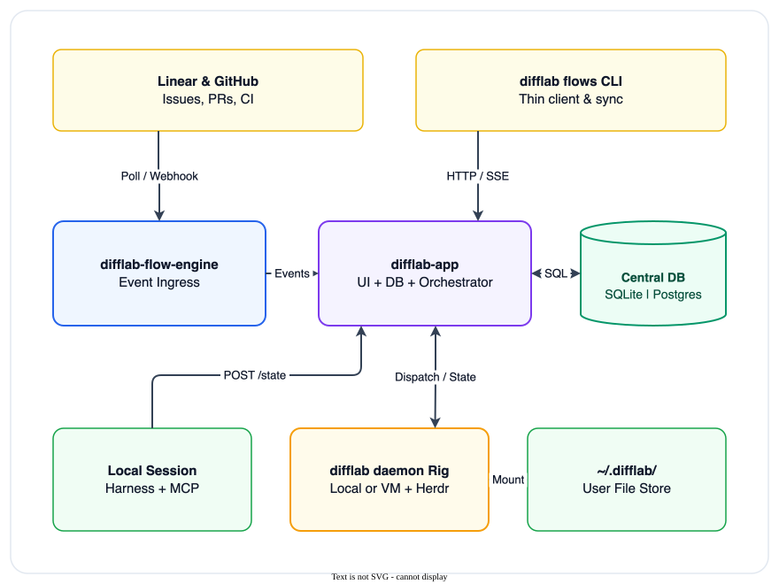
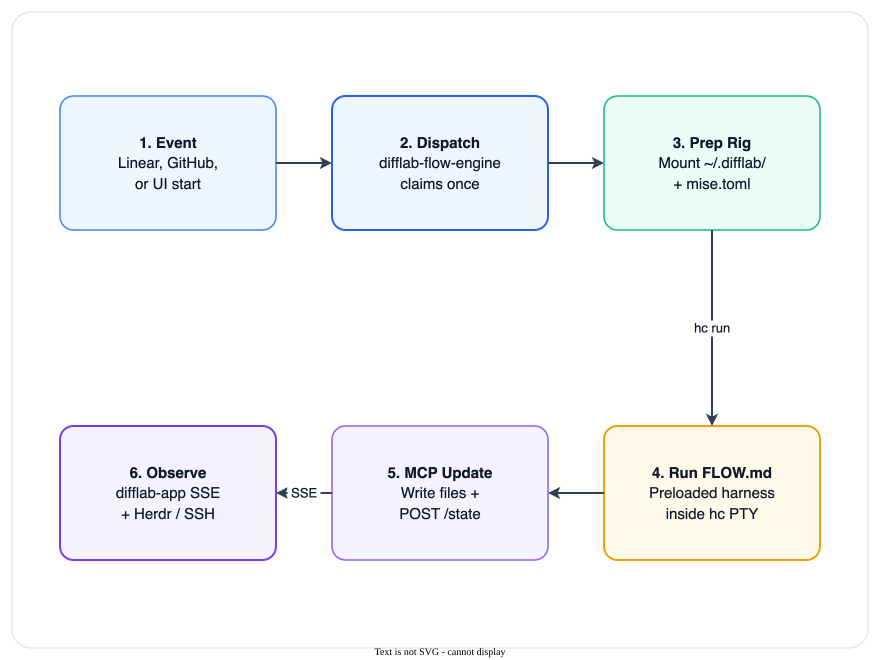
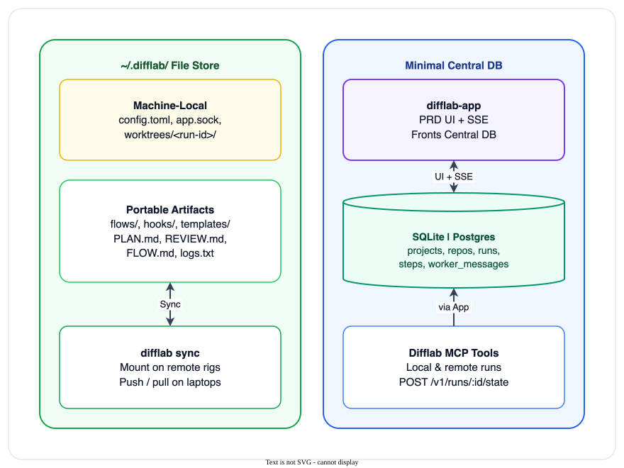

# Difflab platform architecture

## Overview

Difflab is a software engineering platform that runs purely locally, on self-hosted org infrastructure, and on Difflab Cloud. It centers on two simple TypeScript apps (`apps/difflab-app` and `apps/difflab-flow-engine`) alongside `apps/difflab-cli`, `libs/difflab-db`, and `libs/utils`. `difflab-app` renders the Difflab UI per PRD 0001, fronts the minimal Central DB (`difflab.sqlite` locally or Postgres remotely), and orchestrates workflow steps by dispatching work to `difflab daemon` locally or on a remote sandbox or VM. `difflab-flow-engine` ingests Linear, GitHub, CI, and review events or webhooks and forwards them to `difflab-app`. The user directory (`~/.difflab/`) stores `flows/`, `hooks/`, `templates/`, `PLAN.md`, `REVIEW.md`, `FLOW.md`, and `logs.txt` outside SQL. Both local interactive and remote dispatched workflows update `difflab-app` over HTTP and SSE when Difflab MCP tools run. This design excludes a separate step-loop runner package, a native desktop app, `diffagent`, telemetry stacks, and ClickHouse from scope.

## Requirement

### Functional

Users and agents interact with Difflab through these capabilities:

- Users can view and manage projects, plans, reviews, flows, tasks, and wikis in `difflab-app` per PRD 0001.
- Users can trigger local or remote workflows manually or from Linear issues, GitHub pull requests, CI checks, and `lgtm` reviews.
- Users can watch live workflow states, step status, and `worker_message` updates in `difflab-app` and `lgtm`.
- Engineers can mount or sync `~/.difflab/` across remote rigs and push or pull changes from laptops with `difflab sync`.
- Engineers can observe live `hc` sessions in `Herdr.app` and attach over SSH to any active terminal.
- Engineers can extend local interactive sessions with synchronous hooks (`HOOK.md`).

### Non-Functional

Deployments and workflow runs meet these operational guarantees:

- Purely local users can run offline with zero login, zero remote storage, and `~/.difflab/difflab.sqlite` as the local Central DB.
- Self-hosted teams and signed-in Difflab Cloud users share the same `difflab-app` HTTP and SSE API and portable `~/.difflab/` layout.
- Supported repositories require a `mise.toml` file so every local and remote rig activates one deterministic project toolchain.
- Each execution rig preloads `difflab`, MCP tools, and Difflab skills per run with zero edits to personal agent settings.
- Each subscribed event starts at most one workflow run per target flow across retries, restarts, and concurrent rigs.
- Operators can connect remote rigs from behind NAT or firewalls over outbound HTTPS with no inbound ports.

## Design

### Components and Responsibilities



Each component owns one clear boundary:

- `apps/difflab-app` runs locally or remotely, renders the PRD 0001 UI, fronts the Central DB, orchestrates workflow steps, and dispatches step jobs to `difflab daemon`.
- `apps/difflab-flow-engine` runs locally or remotely, ingests Linear, GitHub, and review events or webhooks, and forwards normalized events to `difflab-app`.
- `apps/difflab-cli` provides `difflab daemon` (local or remote rig step worker over `mise` and Herdr), thin `difflab flows` CLI commands, `difflab sync`, and MCP tools.
- `libs/difflab-db` defines the minimal Central DB schema (`projects`, `repositories`, `runs`, `steps`, and `worker_messages`).
- `libs/utils` provides shared `gitx`, `processx`, `misex`, and `herdrx` helpers used on local workstations and remote rigs (`TBD`).
- Herdr hosts persistent agent tabs and PTY sessions that engineers inspect locally or attach to over SSH.
- `lgtm` renders plan and diff reviews plus flow timelines from `difflab-app` over HTTP and SSE.

### Data and Control Flow



Linear, GitHub, CI, and review events reach `difflab-flow-engine` through local pollers or remote webhooks. The flow engine claims the event key once, records the run through `difflab-app`, and dispatches a `mise` and `hc` session onto a target rig. Inside that session, Difflab MCP tools write `FLOW.md` and `logs.txt` in `~/.difflab/` while posting workflow states and `worker_message` updates to `difflab-app`. Local interactive sessions call those exact same MCP tools so `difflab-app` shows local and remote runs uniformly.

### Storage Model: User Store vs Minimal Central DB



```text
[M] modified  [A] added  [D] deleted  [R] renamed
~/.difflab/                                     user store root (linked via <repo>/.difflab -> projects/<KEY>/<slug>)
├── [A] config.toml                             machine-local: app URL, auth token, default_harness, worktree retention
├── [M] difflab.sqlite                          projects + repositories today -> local Central DB fronted by difflab-app
├── [A] app.sock                                machine-local: UNIX HTTP + SSE socket for local difflab-app
├── [A] worktrees/<run-id>/                     machine-local: ephemeral checkouts outside projects/ spared from sync
├── flows/<name>.md                             portable user store: reusable workflow definitions (mounted/synced)
├── hooks/<name>/HOOK.md                        portable user store: synchronous local hooks (mounted/synced)
├── templates/                                  portable user store: scaffold templates (plus template-backups/, recovery/, diffpi/)
└── [M] projects/<KEY>/<repo-slug>/             portable user store (mounted/synced across rigs, pushed/pulled from laptops)
    ├── plans/                                  existing PLAN.md, INTENT.md, revisions/, logs.txt
    ├── reviews/                                existing REVIEW.md, rubric.yaml
    ├── explore/                                existing research and proposals
    └── [M] flows/<YYMMDD-run-id>/              FLOW.md + logs.txt + per-run harness preload settings
```

Right now `~/.difflab/difflab.sqlite` holds only `projects` and `repositories` tables from `001_initial`, while plans, reviews, flows, and logs live under `~/.difflab/projects/...`. Purely local users keep `~/.difflab/` on workstation disk and use `difflab.sqlite` as the local Central DB fronted by `difflab-app`. In self-hosted or Cloud modes, Postgres stores only minimal UI state (`runs`, `steps`, `worker_messages`) and dispatch keys behind `difflab-app`. Org or Cloud shared storage backs each user `~/.difflab/` directory. Remote rigs mount or sync that user store into `~/.difflab/`, and laptops push and pull changes with `difflab sync`.

### Interfaces and Contracts

In purely local mode, CLI MCP tools and `difflab-flow-engine` talk to `difflab-app` over `unix://~/.difflab/app.sock` or localhost HTTP. In self-hosted and Cloud modes, rigs and laptops connect outbound over `https://<difflab-host>` with a scoped bearer token stored in `config.toml`. Every mode uses the same `difflab-app` HTTP and SSE routes (`POST /v1/runs`, `POST /v1/runs/:id/state`, `POST /v1/triggers/linear`, `GET /v1/runs`, and `GET /v1/stream`).

## Implementation

### Monorepo layout with Premise (Bun TypeScript packages)

```text
[M] modified  [A] added  [D] deleted  [R] renamed
difflab/
├── [M] premise.yaml                            register new Bun apps in workspace
├── [M] libs/utils/                             shared gitx worktree, processx, misex, and herdrx helpers
├── [M] libs/difflab-db/                        minimal Central DB: projects, repositories, org_id, runs, steps, worker_messages
├── [A] apps/difflab-app/                       local and remote TS web app: PRD 0001 UI + Central DB front + flow step orchestrator
├── [A] apps/difflab-flow-engine/               local and remote TS event ingress: Linear/GitHub pollers + webhooks -> difflab-app
├── [M] apps/difflab-cli/                       difflab daemon rig worker, thin difflab flows client, difflab sync, MCP tools
├── [A] e2e/                                    top-level Vitest + Playwright E2E suites and offline cassettes
└── [A] docs/architecture/
    ├── [A] index.md                            platform architecture specification
    ├── [A] workflows.md                        workflow execution specification
    └── [A] diagrams/                           editable .drawio.svg architecture diagrams
```

Premise scaffolds every package in TypeScript on Bun (`cloudvoyant/premise-bun`). `apps/difflab-app`, `apps/difflab-flow-engine`, and `apps/difflab-cli` share Zod schemas, while `difflab-app` fronts `libs/difflab-db` with no separate step-loop runner package. Locally, `difflab daemon` runs `difflab-app` against `difflab.sqlite` alongside `difflab-flow-engine`. Remote deployments run `difflab-app` on Postgres alongside `difflab-flow-engine` webhook listeners.

### Execution rigs, required mise.toml, and preloaded tools

Supported repositories require a `mise.toml` file so every project uses one deterministic `mise` activation path across local and remote hosts. Remote rigs and per-user VMs pre-install `mise` with `hc` (`herdr-core`), `difflab`, agent harnesses (`claude`, `agy`, `codex`, `pi`), and core developer tools. Before launch, the rig prepares a worktree under `~/.difflab/worktrees/<run-id>/`, mounts `~/.difflab/`, runs `difflab init`, and activates `mise.toml`. It then preloads `difflab`, MCP tools, and Difflab skills per run.

### Boundaries between hooks, dispatch, and rigs

`difflab-hooks` (`HOOK.md`) run synchronously inside an interactive agent session and do not call `difflab-app` or `difflab-flow-engine`. Ready Linear task triggers and manual `FLOW.md` runs pass through `difflab-app` onto local or remote `difflab daemon` rigs. Interactive foreground workflows still post state to `difflab-app` through MCP tool calls so the UI shows all active work.

## References

- [Difflab workflow architecture](./workflows.md)
- [PRD 0001: Core concepts](../../prd/0001-core-concepts/README.md)
- [Database schema](../../libs/difflab-db/src/schema.ts)
- [Database migrations](../../libs/difflab-db/src/migrations.ts)
- [User store: user-store.ts](../../apps/difflab-cli/src/store/user-store.ts)
