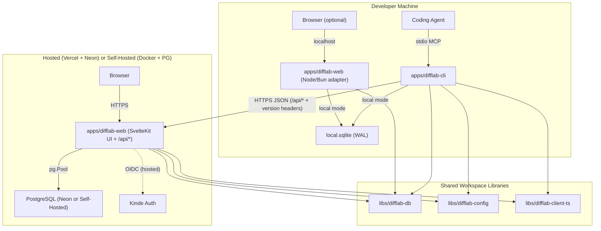
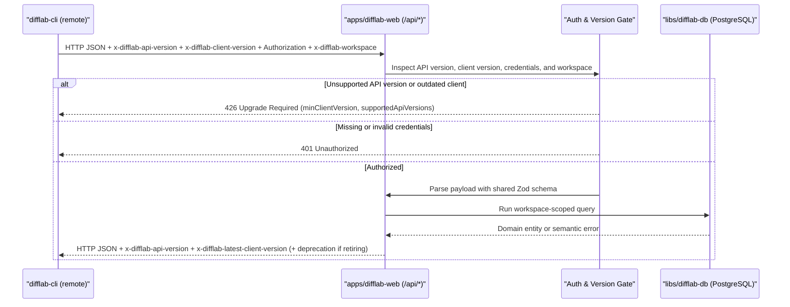
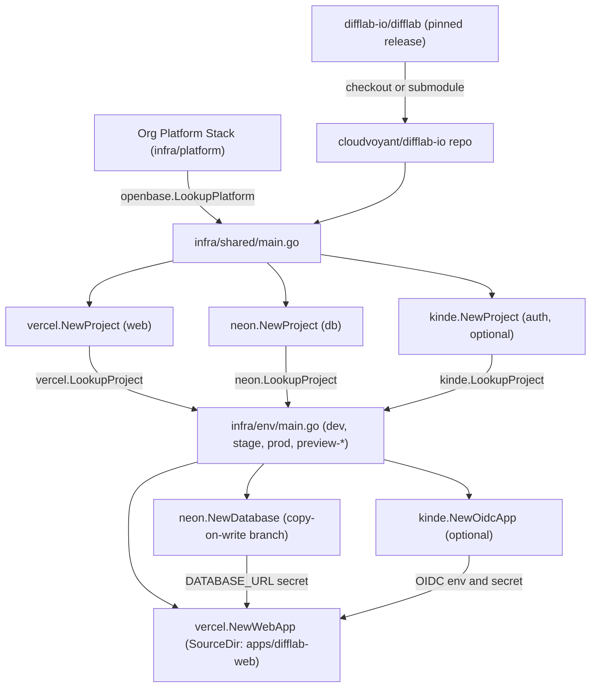

# Difflab: software architecture

## Overview

Difflab is a developer platform for agent-assisted planning, code review, and workflow tracking. It serves engineers and coding agents across three runtime modes: a local mode on a developer machine, a hosted cloud mode on Vercel and Neon, and a self-hosted mode over PostgreSQL. Local operations run through the command-line tool, the stdio MCP (Model Context Protocol, a tool bridge for agents) server, and an optional local web UI without Docker or an account. Hosted and self-hosted deployments run one SvelteKit application that serves both the browser UI and a header-versioned JSON HTTP API for remote clients. Multi-language RPC SDKs, native desktop shells, and GCP compute services are out of scope.

## Requirement

### Functional

- Developers can manage projects, plans, reviews, and workflows locally through the CLI, agent tools, and a browser UI without creating a cloud account or running external services.
- Teams can access the same web experience and remote CLI operations against a hosted cloud deployment or a self-hosted instance.
- Remote CLI callers receive an explicit upgrade error when their client version is incompatible with the target server.
- Hosted deployments restrict every workspace operation to authenticated callers and authorized workspace members.

### Non-Functional

- Local CLI and agent tool invocations complete in milliseconds and allow concurrent local readers and writers alongside a local browser session.
- Older installed CLI clients continue working across routine server releases without requiring immediate upgrades.
- Hosted deployments scale on demand without idle compute overhead and keep tenant data strictly isolated per workspace.
- Uninitialized or misconfigured hosted instances refuse traffic before serving requests.

## Design

### Components and Responsibilities

- `apps/difflab-web` is the single SvelteKit application. It renders the web UI and exposes `/api/*` JSON endpoints with header-based version negotiation for remote CLI clients.
- `apps/difflab-cli` owns local repository workflows, templates, and the stdio MCP server. It reads `local.sqlite` directly in local mode and calls `/api/*` through `libs/difflab-client-ts` in remote mode.
- `libs/difflab-db` owns Kysely queries, Zod domain models, and migrations for both SQLite (local) and PostgreSQL (hosted and self-hosted).
- `libs/difflab-client-ts` owns the shared Zod API schemas and typed HTTP JSON client for `/api/*`.
- `libs/difflab-config` resolves environment variables, state directory paths, and `difflab.yaml` repository manifests.
- `apps/difflab-web/Dockerfile` and root `docker-compose.yml` in this repository package `apps/difflab-web` for generic self-hosting over PostgreSQL.
- A separate `cloudvoyant/difflab-io` deployment repository provisions hosted Vercel, Neon, and Kinde infrastructure with Premise Pulumi and OpenBase against pinned releases of this repository.

### Data and Control Flow

In local mode, `apps/difflab-cli` and a local `difflab ui` process open `$DIFFLAB_HOME/local.sqlite` directly through `libs/difflab-db` in WAL (write-ahead logging, a mode that lets readers and writers run together) mode. Authentication is bypassed on loopback and workspace scope defaults to `local`.

In hosted and self-hosted modes, browser sessions authenticate through SvelteKit server hooks and cookies, while remote CLI requests send `Authorization: Bearer <token>`, `x-difflab-workspace`, `x-difflab-api-version`, and `x-difflab-client-version` to `/api/*`. Both paths call the same server domain services backed by `libs/difflab-db` over PostgreSQL.

### Interfaces and Contracts

#### Runtime Modes

| Mode                 | Web Runtime                                     | Database                          | Auth                                                                           | Provisioning                                      |
| :------------------- | :---------------------------------------------- | :-------------------------------- | :----------------------------------------------------------------------------- | :------------------------------------------------ |
| Local (`difflab ui`) | SvelteKit (`adapter-node` / Bun) on `127.0.0.1` | `$DIFFLAB_HOME/local.sqlite`      | Loopback bypass                                                                | Local CLI (`@difflab/difflab-web@<cliVersion>`)   |
| Hosted (Vercel)      | SvelteKit (`adapter-vercel`)                    | Neon PostgreSQL (`neon.Database`) | Generic OIDC (wired to Kinde in `cloudvoyant/difflab-io`) + Bearer token (CLI) | OpenBase (`vercel.WebApp` + `neon.Database`)      |
| Self-hosted          | SvelteKit (`adapter-node`) in container         | PostgreSQL                        | Configured auth or Bearer token                                                | Docker Compose (`ghcr.io/difflab-io/difflab-web`) |

#### HTTP Endpoints

| Endpoint          | Scope     | Contract                                                                                         |
| :---------------- | :-------- | :----------------------------------------------------------------------------------------------- |
| `GET /api/health` | All modes | Returns `{ ok, mode, apiVersion, supportedApiVersions, minClientVersion, latestClientVersion }`. |
| `/api/*`          | All modes | Stable JSON HTTP endpoints parsed with shared Zod schemas from `libs/difflab-client-ts`.         |

#### API Version and Auth Headers

| Header                            | Direction / Scope             | Contract                                                                                                          |
| :-------------------------------- | :---------------------------- | :---------------------------------------------------------------------------------------------------------------- |
| `x-difflab-api-version`           | Request and response          | Negotiates the API contract version without changing URLs. Missing request header defaults to the latest version. |
| `x-difflab-client-version`        | Request (remote CLI)          | Semver string sent by `libs/difflab-client-ts`. Server returns `426` when below `minClientVersion`.               |
| `x-difflab-latest-client-version` | Response (all `/api/*`)       | Latest published CLI version so `difflab-cli` prints a non-blocking update notice on `stderr`.                    |
| `deprecation` and `sunset`        | Response (retiring version)   | Standard HTTP headers warning `difflab-cli` before an API version is removed.                                     |
| `Authorization: Bearer <token>`   | Request (hosted, self-hosted) | Required on remote CLI requests. Compared in constant time or parsed as a signed token.                           |
| `x-difflab-workspace`             | Request (hosted, self-hosted) | Required workspace identifier (`1..64` characters) for tenant scoping.                                            |

## Implementation

### SvelteKit Adapter and Local Packaging

`apps/difflab-web/svelte.config.js` selects `@sveltejs/adapter-vercel` when `VERCEL` is set and `@sveltejs/adapter-node` otherwise. This keeps one SvelteKit build pipeline for Vercel, Docker self-hosting, and local `difflab ui`. To keep `@difflab/difflab-cli` small and prevent schema skew, `difflab ui` launches the exact matching `@difflab/difflab-web@<cliVersion>` package on demand using the version baked into the CLI build.

### Header-Negotiated JSON API and Compatibility

Stable `/api/*` routes replace Protocol Buffers and `buf` code generation with shared Zod schemas in `libs/difflab-client-ts`. SvelteKit server middleware handles `x-difflab-api-version` and `x-difflab-client-version` in one place so clients do not change URLs across versions. Additive JSON changes stay within the active version, and client response schemas ignore unknown fields so older CLI binaries keep working against newer deployments. Every `/api/*` response includes `x-difflab-latest-client-version` (and `deprecation` or `sunset` when a version is retiring) so the local CLI notifies users of updates automatically, while unsupported versions return `426 Upgrade Required`. As `/api/*` routes land in `apps/difflab-web`, `apps/difflab-api` is retired.

### Hosted Cloud Topology (`cloudvoyant/difflab-io`)

This repository stays vendor-neutral and ships no cloud infrastructure code. The separate `cloudvoyant/difflab-io` repository runs `pm infra apply --shared` once for `infra/shared` and `pm infra apply --env <env>` per environment (`dev`, `stage`, `prod`, `preview-<slug>`). Database migrations run against `DATABASE_URL` before each deployment through the `migrate` task in `mise.toml`. No GCP compute resources are provisioned.

### Dual-Dialect Storage Boundary

`libs/difflab-db` keeps SQLite (`bun:sqlite`) for concurrent local CLI, MCP, and local UI access and PostgreSQL (`pg.Pool`) for hosted and self-hosted deployments. The SQLite adapter must load lazily only when the SQLite dialect is selected so Vercel Node serverless bundles never import `bun:sqlite` at startup.

## References

- Deployment architecture (Vercel, self-hosted, and local): [./deployment.md](./deployment.md)
- Dual-dialect database architecture: [./difflab-db/index.md](./difflab-db/index.md)
- Configuration architecture: [./difflab-config/index.md](./difflab-config/index.md)
- Environment variables and state layout: [../environment.md](../environment.md)
- Core product concepts PRD: [../../prd/0001-core-concepts/README.md](../../prd/0001-core-concepts/README.md)
- Superseded Connect RPC architecture: [./difflab-api/index.md](./difflab-api/index.md)
- OpenBase Vercel provider architecture: `github.com/cloudvoyant/openbase/docs/architecture/providers/vercel/index.md`
