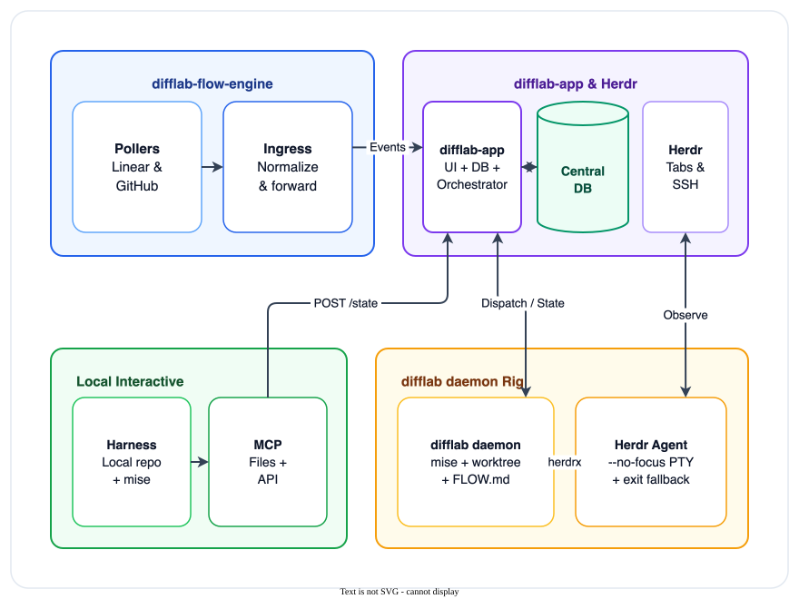
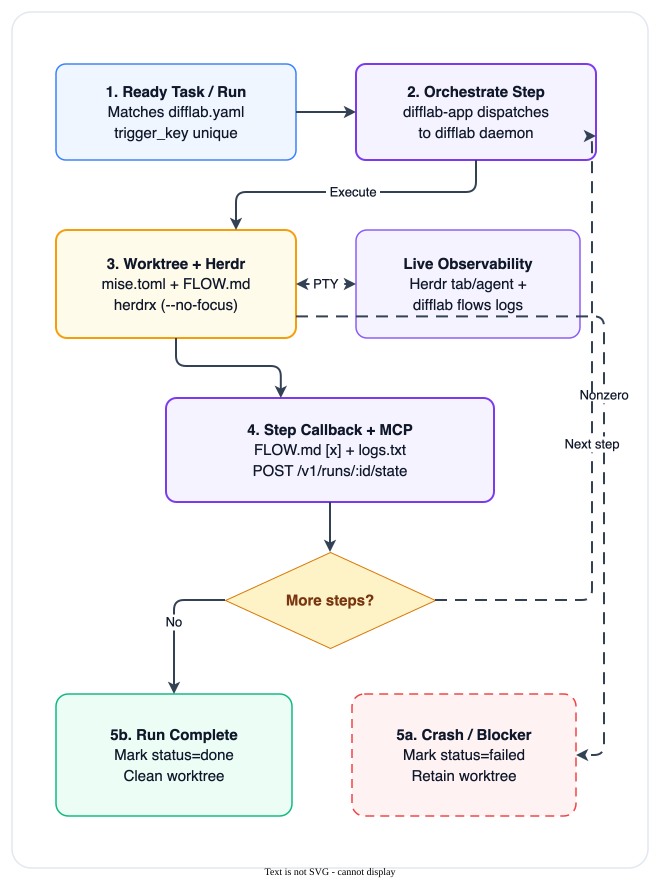
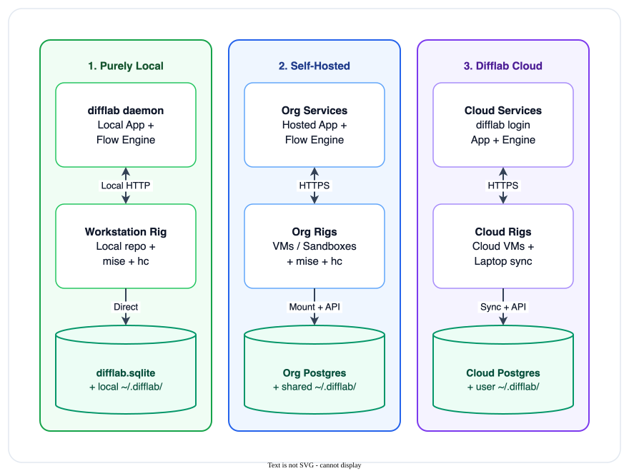
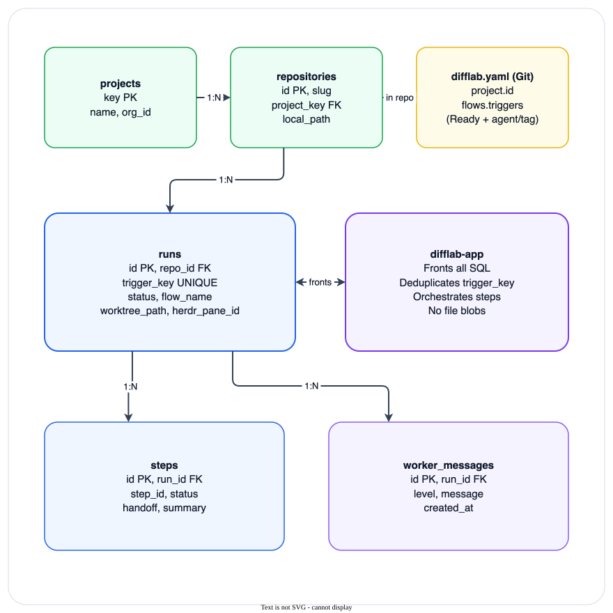
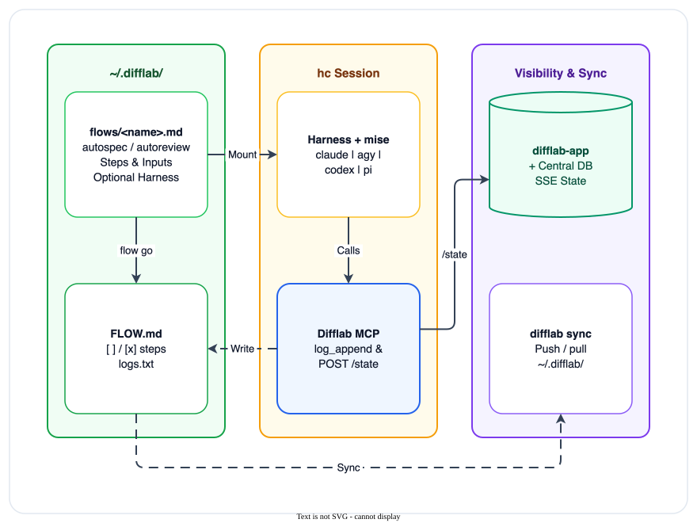
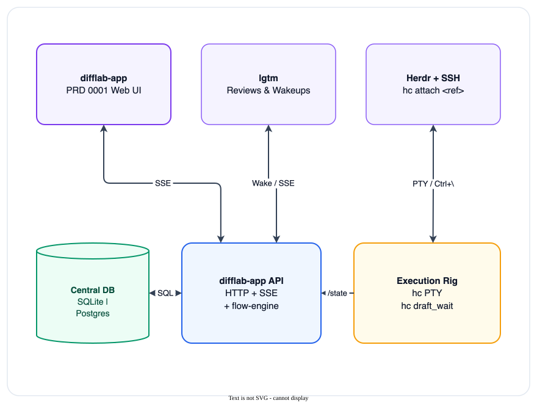

# Difflab workflow architecture

## Overview

The Difflab workflow system separates event ingress (`apps/difflab-flow-engine`), Central DB and step orchestration (`apps/difflab-app`), and rig execution (`difflab daemon` in `apps/difflab-cli`). `difflab-app` fronts the minimal Central DB (`projects`, `repositories`, `runs`, `steps`, and `worker_messages`) on `difflab.sqlite` locally or Postgres remotely. Each repository declares its project and ready-task triggers in `difflab.yaml`. `difflab-flow-engine` polls or receives Linear tasks marked ready and forwards candidates to `difflab-app`. `difflab-app` deduplicates each trigger via `runs.trigger_key`, advances the workflow state machine, and dispatches each step to `difflab daemon` locally or on a remote sandbox or VM (`TBD`). On the rig, `difflab daemon` validates `mise.toml`, prepares an isolated worktree, updates `FLOW.md`, and runs the step inside Herdr (`libs/utils/herdrx`) before posting the outcome back to `difflab-app`.

## Requirement

### Functional

Engineers and teams run workflows through these capabilities:

- Users can start workflows manually from `difflab flows run` or automatically from Linear tasks marked ready that match configured agent, label, or team criteria.
- Teams can declare Linear ready-task trigger rules (`agent`, `labels`, `team`, `flow`) directly in repository `difflab.yaml` files.
- Users can run `FLOW.md` workflows (`autospec`, `autoreview`) across `claude`, `agy`, `codex`, and `pi` with preloaded `difflab`, MCP tools, and Difflab skills.
- Users can inspect live workflow states, `worker_message` feeds, step handoffs, and logs in `difflab-app`, `difflab flows`, and `lgtm` even after worktree cleanup.
- Engineers can mount or sync `~/.difflab/` across remote rigs and push or pull local changes with `difflab sync`.
- Engineers can observe live sessions in Herdr locally and attach over SSH to remote rigs.

### Non-Functional

Workflow execution meets these operational guarantees:

- Purely local users run `difflab daemon`, `difflab-app`, and `difflab-flow-engine` offline with zero containers, zero login, and zero remote sync.
- Supported project repositories require a `mise.toml` file so every rig activates one deterministic toolchain with zero probing.
- Per-run harness flags preload `difflab`, MCP servers, and Difflab skills with zero edits to personal agent settings.
- Each matching Linear ready task starts at most one workflow run per target flow via `runs.trigger_key` uniqueness across retries and restarts.
- Background runs launch with `herdr tab create --no-focus` so automated steps never steal window focus.

## Design

### Components and Responsibilities

Five boundaries keep workflow dispatch, UI visibility, and execution simple:

- `apps/difflab-flow-engine` polls or receives Linear ready-task events and forwards normalized candidates to `difflab-app`.
- `apps/difflab-app` renders the PRD 0001 UI, fronts `difflab.sqlite` or Postgres, deduplicates `trigger_key`, orchestrates workflow steps, and dispatches step jobs to `difflab daemon`.
- `apps/difflab-cli` implements `difflab daemon` (local or remote rig step worker over `mise` and `herdrx`), thin `difflab flows` CLI commands, `difflab sync`, and MCP tools.
- Execution rigs run `difflab daemon` with pre-installed Herdr, `mise`, `difflab`, harnesses, and dev tools, mount or sync user `~/.difflab/`, and activate repository `mise.toml`.
- `difflab daemon` posts a terminal `failed` fallback to `difflab-app` if a step harness crashes or exits nonzero mid-step.

### Data and Control Flow

When a ready Linear task matches `difflab.yaml` criteria or an engineer runs `difflab flows run`, `difflab-app` records the `run` and selected `steps` and dispatches Step 1 to `difflab daemon`. On the rig, `difflab daemon` prepares `~/.difflab/worktrees/<run-id>/`, links `.difflab`, checks `mise.toml`, freezes `FLOW.md`, and launches the step harness inside Herdr (`--no-focus`) with preloaded Difflab MCP and skills. Local interactive and dispatched runs both write `FLOW.md` and `logs.txt` in `~/.difflab/` and post updates to `POST /v1/runs/:id/state` on `difflab-app`. As each step finishes, `difflab-app` resolves handoff slots and dispatches the next step until completion, then calls `/v1/rig/cleanup` so `difflab daemon` applies worktree retention (`on-success` by default, `retain`, or `always`).

### Deployment Topologies

Purely local users run `difflab daemon up`, which supervises `difflab-app` (fronting `~/.difflab/difflab.sqlite`), `difflab-flow-engine`, and the local rig worker with zero remote sync. Self-hosted org deployments host `difflab-app` on org Postgres alongside `difflab-flow-engine`, dispatching steps to `difflab daemon` on org VMs or sandboxes (`TBD`). Users signed into Difflab Cloud (`difflab login`) connect laptops and Cloud rigs outbound over HTTPS to Cloud `difflab-app` and `difflab-flow-engine`.

### Interfaces and Contracts

| Endpoint (`difflab-app` & `difflab daemon`) | Method | Caller | Purpose |
| :-- | :-- | :-- | :-- |
| `/v1/runs` | `POST` | `difflab flows` / UI | Create a workflow run and dispatch Step 1 to `difflab daemon` |
| `/v1/triggers/linear` | `POST` | `difflab-flow-engine` | Match Ready Linear issue against `difflab.yaml` and deduplicate `trigger_key` |
| `/v1/runs/:id/state` | `POST` | `difflab daemon` / MCP tools | Update step/run status, handoff, `worker_message`, and Herdr refs; advance step |
| `/v1/runs` | `GET` | `difflab-app` UI / `lgtm` / CLI | List active and completed runs with states and Herdr refs |
| `/v1/stream` | `GET` | `difflab-app` UI / `lgtm` / CLI | Stream live SSE workflow states, step status, and `worker_message` feeds |
| `/v1/rig/execute` | `POST` | `difflab-app` orchestrator | Execute one dispatched workflow step on local or remote `difflab daemon` |
| `/v1/rig/cleanup` | `POST` | `difflab-app` orchestrator | Enforce worktree retention (`on-success`, `retain`, `always`) on `difflab daemon` |

| Harness | Unattended Flags | Per-Run Preload Flags (`difflab`, MCP, skills) |
| :-- | :-- | :-- |
| `claude` | `--dangerously-skip-permissions` | `--settings <run.json>` `--session-id <uuid>` |
| `agy` | `--dangerously-skip-permissions` | `--settings <run.json>` |
| `codex` | `--dangerously-bypass-approvals-and-sandbox` `--no-daemon` | `-c <key=value>` |
| `pi` | `--approve` | `--extension <difflab.ts>` `--session-dir <dir>` |

`apps/difflab-app`, `apps/difflab-flow-engine`, and `apps/difflab-cli` share Zod schemas, while `difflab-app` owns all reads and writes against `libs/difflab-db`. Keeping `PLAN.md`, `REVIEW.md`, `FLOW.md`, and `logs.txt` out of SQL keeps the database limited strictly to trigger deduplication and UI state.

## Implementation

### Current difflab-flow baseline and lightweight execution

Reusable definitions (`autospec.md`, `autoreview.md`) live at `~/.difflab/flows/<name>.md` with `Intent`, `Inputs`, `Flags`, numbered `Steps` (`Handler`, `When`, `Unless`, `Requires`, `Receives`, `Produces`, `Instructions`, and optional `Harness`), and `Contract`. In interactive sessions, `flow go` freezes `.difflab/flows/YYMMDD-<name>/FLOW.md` with `- [ ]` step checkboxes, `Result/handoff`, `Blocker`, and `logs.txt` via MCP `log_append`. Orchestrated runs keep that exact Markdown format with zero YAML, DAG, or DSL bloat, so interactive `flow go` and daemon-executed runs produce identical artifacts.

### Required mise.toml rigs and preloaded MCP tools

Supported repositories require a `mise.toml` file, and every rig pre-installs `mise` with Herdr, `difflab`, coding harnesses, and developer tools. Before launch, `difflab daemon` prepares `~/.difflab/worktrees/<run-id>/`, links `.difflab`, and activates `mise.toml` so local commits and generated files stay isolated from the developer's main checkout. Per-step flags preload `difflab`, MCP tools, and Difflab skills without touching personal agent settings.

### Web visibility (difflab-app), CLI inspection, and Herdr observability

`difflab-app` runs locally or remotely, fronts the Central DB, and streams live workflow states, step progress, and `worker_message` feeds over HTTP and SSE. Engineers inspect runs from the terminal with `difflab flows list`, `difflab flows status <id>`, and `difflab flows logs <id> --follow`. Because `difflab daemon` runs steps inside Herdr (`--no-focus`), engineers watch live agent tabs directly in Herdr locally or over SSH on remote rigs.

## References

- [Platform architecture](./index.md)
- [PRD 0001: Core concepts](../../prd/0001-core-concepts/README.md)
- [Template: flow-definition.md](../../apps/difflab-cli/templates/flow-definition.md)
- [Template: flow-instance.md](../../apps/difflab-cli/templates/flow-instance.md)
- [Database schema](../../libs/difflab-db/src/schema.ts)
- [Database migrations](../../libs/difflab-db/src/migrations.ts)
- [User store: user-store.ts](../../apps/difflab-cli/src/store/user-store.ts)
