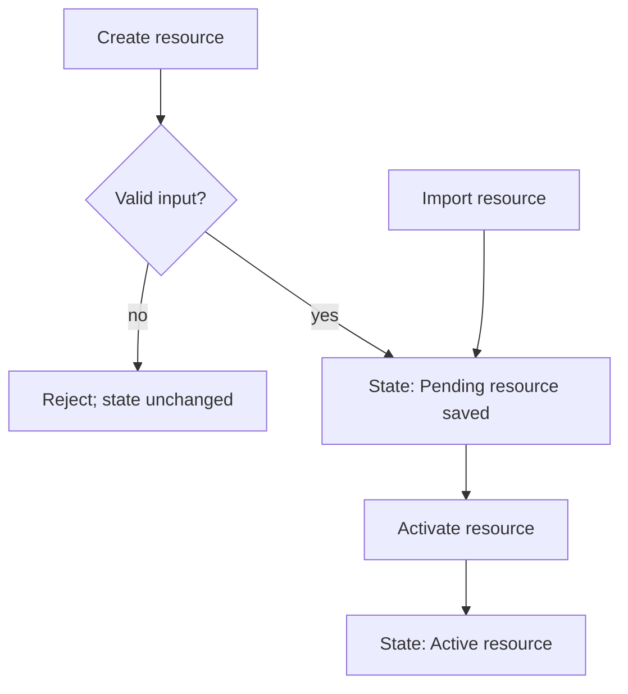

# Difflab BDD

Model and test component behavior from the user's or caller's perspective. Use this skill when designing test plans in `/difflab-plan`, writing or reorganizing test suites, and evaluating test quality in `/difflab-review`.

## 1. Map behavior as a flowchart

Draw a Mermaid `flowchart TD` showing how user or caller actions move through context branches and states before writing or reviewing tests.

- Identify branches where multiple inputs or preconditions converge to a single intermediate state.
- Once branches converge to a verified state, test downstream transitions once from that converged state. Do not duplicate the full tail of the behavior tree across every upstream branch.
- Select test paths that cover distinct behavioral branches and state transitions rather than chasing line or function coverage.



## 2. Mirror the flowchart in the BDD test tree

Translate the behavior flowchart directly into a nested `[M/A/D/R]` test tree using `given`, `when`, and `then` (or `it`) clauses:

- Start at the top level directly with `given <context>`, or use an optional top-level `describe`/`feature <name>` when helpful.
- Nest only to the depth needed:
  - Expand `when <action>` into child `then <outcome>` nodes when asserting multiple distinct outcomes or branches.
  - Collapse `when <action>, then <outcome>` into a single leaf test when no further nesting is needed.
- Nest `given` inside an outer `given` when grouping multiple large functions in a module or related endpoints.
- Flip `when` and `given` (`when <action>` -> `given <context>, then <outcome>`) when an action-first hierarchy makes the suite easier to read.
- Hoist shared setup and fixtures up to the enclosing `given` scope so leaf tests keep concise Arrange, Act, and Assert steps.

```text
src/
└── resources/
    └── [M] service.spec.ts
        ├── [A] given a new resource request
        │   ├── [A] when input is invalid, then it rejects without saving
        │   └── [A] when input is valid, then it saves a pending resource
        ├── [A] given an imported resource, when imported, then it reaches the pending state
        └── [A] given a pending resource (converged state)
            └── [A] when activated
                ├── [A] then status becomes active
                └── [A] then an activation log entry is recorded
```

## 3. Prioritize test layers (`e2e` > `integration` > `unit`)

| Layer | Scope | When to use |
| --- | --- | --- |
| `e2e` | External client over Playwright, HTTP/network, CLI subprocess, or stdio protocol. | Primary proof of user-observable application behavior. |
| `integration` | Module public APIs with real local stores/dependencies and minimal mocking. | Reduce `e2e` execution cost, test states hard to trigger through the UI, or decouple module contracts from UI/transport details. |
| `unit` | Focused pure functions or internal algorithms. | Performance-critical paths and complex algorithmic branches whose behavioral risk cannot be isolated cleanly through higher layers. |

## 4. Produce human-verifiable artifacts

Tests must optimize for both behavioral coverage and human verifiability:

- Capture artifacts that are easy to inspect visually or diff directly: Playwright screenshots, screen replays/traces, file dumps, snapshots, and JSON request/response payloads.
- Use structured debug logs in integration and e2e tests to verify internal module invariants without coupling tests to private function mocks.
