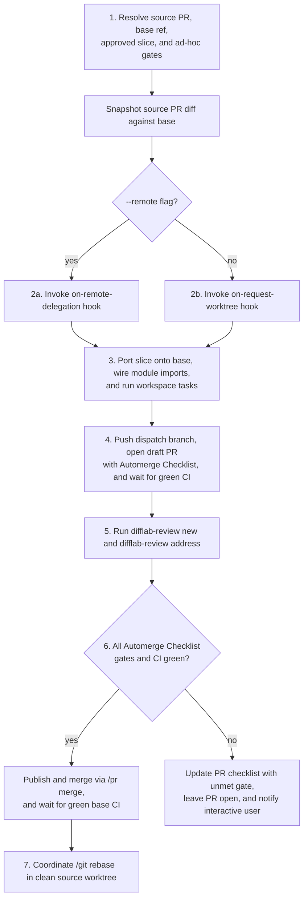

# Dispatch a pull request slice

## 1. Resolve source pull request and approved slice

1. Resolve the open source pull request (or source branch and worktree), its target `<base_ref>` (such as `origin/main`), and the repository `project_key` and `repo_slug` from `project_context`.
2. If the user named explicit approved files, make sure that those files exist in the source diff against `<base_ref>`. If the user did not specify exact files, inspect the source pull request diff and review threads, propose self-contained candidate slices that compile cleanly on `<base_ref>`, and ask the user to approve one slice and any extra automerge conditions before mutating anything.
3. Capture the exact `git diff <base_ref>...<source_head>` snapshot as the immutable parity baseline, and derive a branch name `dispatch/<source-slug>-<slice-slug>`.

## 2. Provision worktree or remote delegation

1. With `--remote`, invoke `on-remote-delegation` via [difflab-hooks](../../../difflab-hooks/SKILL.md) (`hooks invoke on-remote-delegation`) with `project_key`, `repo_origin`, `base_ref`, `branch_name`, `approved_files`, `automerge_rules`, and `task_brief` (steps 3 through 7 below).
2. Without `--remote`, invoke `on-request-worktree` via [difflab-hooks](../../../difflab-hooks/SKILL.md) (`hooks invoke on-request-worktree`) with `project_key`, `repo_slug`, `source_root`, `base_ref`, `branch_name`, `branch_slug`, and `task_brief`. Under `Handler: default`, create a Git worktree at `~/.difflab/worktrees/<project_key>/<repo_slug>/<branch_slug>` on `<branch_name>` starting at `<base_ref>`, run `difflab init <project_key>`, and coordinate with a native subagent in the current harness.

## 3. Port the slice and run local tasks

1. In the dispatch worktree (without calling `difflab-plan`), bring over the approved files from the source branch onto `<base_ref>`. For shared root files (such as `.gitignore`, `.prettierignore`, `premise.yaml`, or `mise.toml`), carry over only the hunks needed by this slice verbatim from the source diff.
2. Apply only minimal module-resolution wiring outside the approved slice (`import` or `export` path updates, `package.json` workspace dependencies or `exports`, `tsconfig` paths, and lockfile sync) so `<base_ref>` builds cleanly.
3. Run workspace format, lint, build, unit, integration, and `e2e` tasks through the repository task runner (`mise.toml`). Make sure that newly added packages or test suites appear in the task-runner output rather than passing vacuously.

## 4. Open draft pull request and run review round

1. Commit only intended slice and module-wiring files, push `<branch_name>`, and create a draft pull request targeting `<base_ref>` via [pr](../../../pr/SKILL.md) (`pr draft`) using `pull-request-description`. Link the parent pull request in `## References` and include the `### Automerge Checklist` from [gates](gates.md) under `## Validation` with all items unchecked.
2. Wait for remote continuous integration and `e2e` runs on the pushed head SHA to pass.
3. Run one round of `review new` followed by `review address` via [difflab-review](../../../difflab-review/SKILL.md) on the dispatch pull request. If `review address` pushes a follow-up commit, wait for remote continuous integration and `e2e` runs on the new head SHA to pass.

## 5. Evaluate Automerge Checklist, merge, and rebase source

1. Evaluate every gate in [gates](gates.md) against `git diff <base_ref>...HEAD`, the snapshotted source pull request diff, open review threads, and continuous integration results. Update the `### Automerge Checklist` checkboxes on the dispatch pull request description via `pr update` to reflect verified evidence.
2. If every gate passes and zero unresolved review threads remain, mark the pull request ready (`pr publish`), merge it via [pr](../../../pr/SKILL.md) (`pr merge`), and wait for post-merge continuous integration on `<base_ref>` to pass.
3. Once post-merge continuous integration on `<base_ref>` is green, coordinate over the inter-worktree channel from `on-request-worktree` to run `/git rebase <base_ref>` via [git](../../../git/SKILL.md) in the source worktree when its working tree is clean and idle. If the source worktree is dirty, busy, or unreachable, skip automatic rebase and report the exact rebase command.
4. If any gate in [gates](gates.md) fails, do not publish or merge. Leave the dispatch pull request open with the unmet gate recorded in `### Automerge Checklist`, report the pull request URL and exact failing gate, and notify the user immediately when running in an interactive session.
