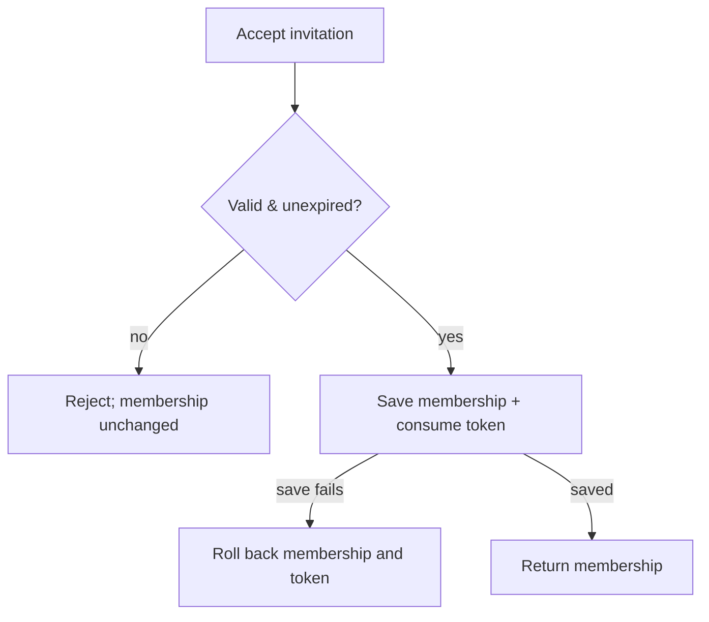

# Write a plan people can audit and an agent can execute

Read this guide for `plan new` and `plan update`, and invoke [difflab-writing-style](../../difflab-writing-style/SKILL.md) and [difflab-bdd](../../difflab-bdd/SKILL.md). Inspect the relevant code and applicable `AGENTS.md` files first. Use short sentences, concrete paths, and repository terminology. Preserve requirements when shortening prose.

## Give each section one job

| Section | Contents |
| --- | --- |
| Intent | Who needs the outcome and why. |
| Requirements | Observable behavior, constraints, and explicit non-goals. |
| Big Ideas | Diagram-led explanation of changed relationships and flows. Omit prose when diagrams suffice. Keep decisions and constraints beside each visual. |
| Infrastructure Changes | Actual hosting, services, deployment, networking, or managed resources. Write `N/A.` if none change. New source modules belong in Repo Changes. |
| Interfaces | Short commands, signatures, code, or pseudocode showing interactions and contracts, including important failure results. |
| Consequences | Start with `Repo Changes` (`[M/A/D/R]` file tree), then `Testing` (behavior flowchart and `[M/A/D/R]` BDD test tree via `/difflab-bdd`), then `Trade-offs`. |
| Phases | Ordered, bounded actions with file/module targets and relevant checks. Refer to design contracts rather than repeating them. |

Apply `/difflab-writing-style` throughout. Prefer compact Mermaid or Draw.io diagrams over prose; drop explanations when visuals are sufficient. Keep only decisions, constraints, and failure rules beside the visuals. Adding diagrams must not move all useful design detail into a giant implementation checklist. Tasks still need enough local detail to act without the original chat.

## Show the change

- Use a component diagram for new components or changed relationships. Label responsibilities and dependencies; show before/after relationships when useful.
- Use a flowchart for a new process. Include its important branches and failure/retry behavior.
- Show new file-based artifacts as a tree or another suitable visual. Distinguish runtime data layout from repository source changes.
- Use Mermaid for diagrams and fenced text for trees. Draw the affected parts, not the whole system. A small change can use a single compact visual; omit irrelevant diagram types.

Start `Consequences` with this shape:

```text
### Consequences

#### Repo Changes

[M] modified  [A] added  [D] deleted  [R] renamed
src/
└── feature/
    ├── [M] service.ts   owns feature policy (largest edit)
    ├── [A] store.ts     owns persistence
    └── [M] adapters/    update transport bindings
```



```text
#### Testing

src/
└── invitations/
    └── [M] service.spec.ts
        └── [A] given an invitation acceptance request
            ├── [A] when the invite is valid, then membership appears
            ├── [A] when the invite is expired, then it rejects without changing membership
            └── [A] when saving fails
                ├── [A] then membership changes roll back
                └── [A] then the token remains unconsumed
```

Group shared path prefixes under parent directories and collapse directory-level changes when listing every leaf adds no clarity. Use inspected paths for existing files and label proposed paths as new. Put `[M]`, `[A]`, `[D]`, or `[R]` before each changed entry in both `Repo Changes` and `Testing`. Include removed or renamed files and identify the largest edits in a short note. State when nothing is removed. Make sure that diagrams, interfaces, the tree, and phases agree.

## Specify the behavior to test

Invoke `/difflab-bdd` to design the `Testing` subsection under `Consequences`:

1. Draw a behavior flowchart showing context branches, state transitions, and converging intermediate states from the user's or caller's perspective. When branches converge to a shared state, test downstream behavior once from that state.
2. Translate the flowchart directly into a `[M/A/D/R]` BDD test tree. Start with `given <context>` (or an optional `describe`/`feature <name>`), nest `when <action>` -> `then <outcome>` only as deep as needed, and collapse single-outcome branches to `when <action>, then <outcome>`. Use outer `given` blocks to group multiple functions or endpoints, or flip `when` and `given` when it reads better. Hoist shared fixtures up the tree.
3. Prioritize `e2e` (Playwright, network, CLI, stdio) > `integration` (module public APIs without heavy mocking) > `unit` (performance-critical or complex algorithms). Specify human-verifiable outputs such as screenshots, replays, file dumps, snapshots, JSON outputs, or debug logs for internal invariants.

Inspect the actual test setup before proposing checks. Reuse existing suites and fixtures. Do not invent an end-to-end suite, directory, or runner. For skill-only behavior without a harness, label checks as `manual acceptance`. Keep Arrange, Act, and Assert steps clear. Assert results, saved state, and verifiable artifacts rather than private calls.

Keep commit and green-CI checks when the user expects them, including `plan go --commit`. Use the execution workflow's permissions. If remote CI needs an unauthorized push, report the unmet gate rather than marking it complete.

## Fill old or customized documents

Listing or scaffolding templates installs missing files. It does not refresh existing copies. Apply this guide even when an installed template is older. Add missing subsections to the generated document and keep human content. Do not overwrite installed customizations. On update, save the revision first, then revise design, visuals, interfaces, and tasks together. Preserve phase structure and completed checkboxes unless the requested scope changes a task.

Before saving, check that every requirement has a design home and an implementation/check path. A human should be able to audit the change; an agent should be able to execute it without guessing the key contracts. Leave new implementation tasks unchecked.

## Reference examples

Read these long examples on demand when judging structure and detail:

- [Original plan](examples/plan-sources-before.md): the user's historical example, with its wording preserved. It illustrates the prose-heavy result.
- [Desired plan](examples/plan-sources-after.md): based on the user's desired output and updated for current feedback. It includes the nested Testing section.

These are format references, not instructions to modify a wiki. Their scopes differ, so shortening a plan does not permit dropping requirements. Keep the original as historical evidence. Apply new authoring rules to the desired example and bundled `plan-feature.md` and `plan-migration.md` examples. Use soft wraps for prose. Historical test commands do not set the scope of new plans.
