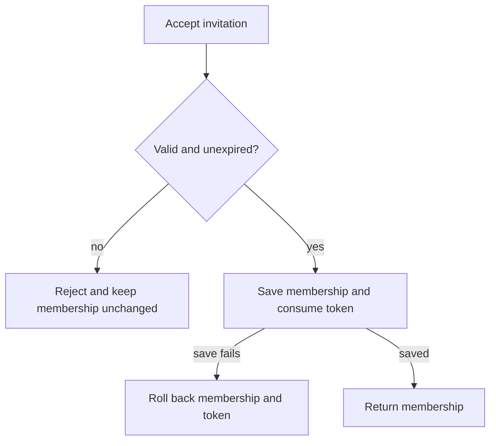

# Write a plan people can audit and an agent can execute

Read this guide for `plan new` and `plan update`, and invoke [difflab-writing-style](../../difflab-writing-style/SKILL.md) and [difflab-bdd](../../difflab-bdd/SKILL.md). Inspect the relevant code and applicable `AGENTS.md` files first. Use short sentences, concrete paths, and repository terminology, and preserve every requirement when shortening prose.

## Give each section one job

| Section | Contents |
| --- | --- |
| Intent | State who needs the outcome and why. |
| Requirements | Use plain bullets without `FR` or `NFR` prefixes. State observable client or end-user behavior, performance, security, cost, isolation, and reliability characteristics, and non-goals. Keep internal types, function names, CLI flags, configuration internals, file layouts, and code-style rules out of `Requirements`. |
| Big Ideas | Lead with diagrams that show changed relationships and flows. Drop prose when diagrams suffice, and keep decisions and constraints beside each visual. |
| Infrastructure Changes | List hosting, services, deployment, network, or managed resources. If none change, write `N/A.` Put new source modules in `Repo Changes`. |
| Interfaces | Show public interactions, contracts, and failure results with compact commands, signatures, code, or pseudocode. |
| Consequences | Start with `Repo Changes` (`[M/A/D/R]` file tree), then `Testing` (behavior flowchart and `[M/A/D/R]` BDD test tree via `/difflab-bdd`), then `Trade-offs`. |
| Phases | List ordered, bounded tasks with file or module targets and validation steps. Reference `Design` contracts instead of repeating them. |

Apply `/difflab-writing-style` throughout the plan. Use compact Mermaid or Draw.io diagrams instead of prose, and drop explanations when visuals show the flow. Keep decisions, constraints, and failure rules beside the visuals. Give phases enough local detail to execute without the original chat.

## Show the change

- Draw a component diagram for new components or changed relationships, and label responsibilities and dependencies.
- Draw a flowchart for a new process with its key branches and failure or retry paths.
- Show new file artifacts as a tree, and separate runtime data layout from repository source changes.
- Use Mermaid for diagrams and fenced text for trees, and draw only the affected parts of the system.

Start `Consequences` with this shape:

```text
### Consequences

#### Repo Changes

[M] modified  [A] added  [D] deleted  [R] renamed
src/
└── feature/
    ├── [M] service.ts   owns feature policy (largest edit)
    ├── [A] store.ts     owns persistence
    └── [M] adapters/    update transport bindings
```



```text
#### Testing

src/
└── invitations/
    └── [M] service.spec.ts
        └── [A] given an invitation acceptance request
            ├── [A] when the invite is valid, then membership appears
            ├── [A] when the invite is expired, then it rejects without changing membership
            └── [A] when saving fails
                ├── [A] then membership changes roll back
                └── [A] then the token remains unconsumed
```

Group shared path prefixes under parent directories and collapse directory-level changes when leaf files add no clarity. Use inspected paths for existing files and label proposed files as new. Put `[M]`, `[A]`, `[D]`, or `[R]` before each changed entry in `Repo Changes` and `Testing`. Note the largest edits, and state when nothing is removed. Make sure that requirements, diagrams, interfaces, trees, and phases agree.

## Specify the behavior to test

Invoke `/difflab-bdd` to design the `Testing` subsection under `Consequences`:

1. Draw a behavior flowchart from the user or caller perspective with context branches, state transitions, and converging states. Test downstream behavior once from each converged state.
2. Map the flowchart to a `[M/A/D/R]` BDD test tree starting at `given <context>` with `when <action>` and `then <outcome>` clauses. Collapse single-outcome branches to `when <action>, then <outcome>`, and hoist shared fixtures.
3. Prioritize `e2e` (Playwright, network, CLI, stdio) over `integration` (module public APIs) over `unit` (complex algorithms). Name human-verifiable outputs such as screenshots, replays, snapshots, JSON payloads, or logs.

Inspect the existing test setup before proposing test tasks, and reuse existing suites and fixtures. Do not invent an end-to-end suite, directory, or runner. If skill behavior has no test harness, label its validation steps `manual acceptance`. Keep Arrange, Act, and Assert steps separate, and assert outputs, saved state, and artifacts rather than private calls.

Keep conditional commit and green-CI gates when the user expects them (such as `plan go --commit`). Follow the execution workflow permissions. If remote CI needs an unauthorized push, report the unmet gate instead of marking it complete.

## Fill old or customized documents

Listing or scaffolding templates installs missing files without replacing existing user copies. Apply this guide even when an installed template is older. Add missing subsections to the generated document, and keep human content intact. On `plan update`, save the revision snapshot first. Update `Requirements`, `Design`, visuals, `Interfaces`, and `Phases` together, and keep completed checkboxes intact unless scope changes a task.

Before saving, make sure that every requirement states an external client or end-user outcome. Map every requirement to a `Design` contract and a `Phases` task. A human can then audit the change, and an agent can execute it without guessing key contracts. Leave new implementation tasks unchecked.

## Reference examples

Read these examples on demand when judging structure and detail:

- [Original plan](examples/plan-sources-before.md): historical example with original wording preserved to show prose-heavy output.
- [Desired plan](examples/plan-sources-after.md): updated example that shows diagram-led design and nested BDD test trees.
- Bundled `plan-feature.md` and `plan-migration.md` templates under `apps/difflab-cli/templates/examples/`: concise feature and migration plan examples.

Treat these files as format references, not instructions to edit a wiki. Keep the original example as historical evidence, and use soft wraps for prose. Never copy historical test commands into unrelated plans.
