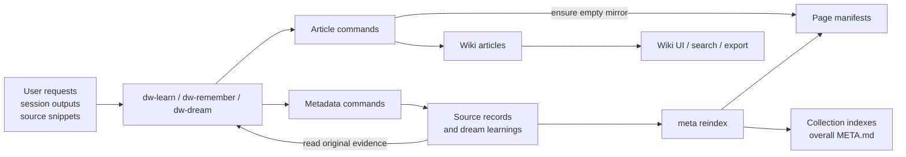
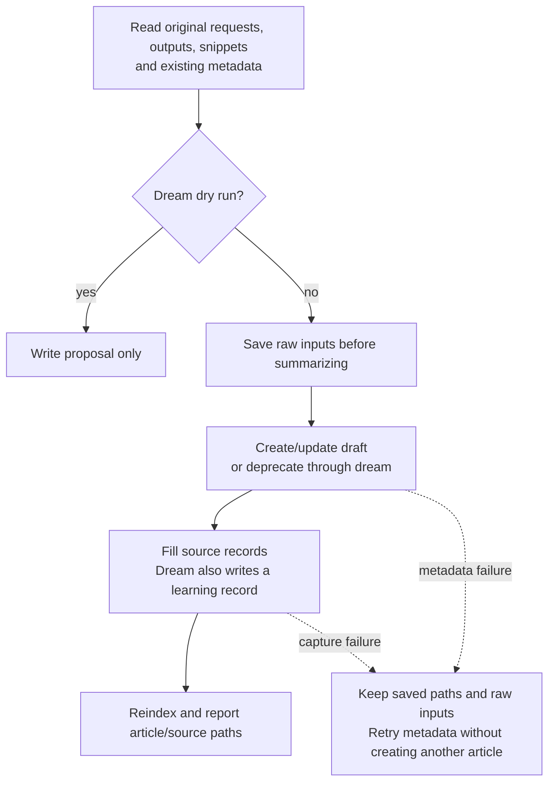

# Preserve sources beside wiki pages

- **Status:** draft
- **Branch:** feature/sources
- **Issue:** none

## Intent

Keep the original evidence behind each wiki page so people can inspect its history and write the page again. Capture user requests, session outputs, source code, and external excerpts before an LLM summarizes them.

Also give collection indexes useful titles and start all sidebar folders collapsed.

## Requirements

1. Store metadata under `resolveHome()/meta`, normally `~/.diffwiki/meta`. Honor `DIFFWIKI_HOME`.
2. Mirror every article's exact collection-relative path, including Markdown, MDX, index, and README files. Cover global collections and collections stored in repositories.
3. Keep collection sources, page sources, and an overall `META.md` index. Link shared evidence instead of copying it between pages.
4. Preserve near-verbatim user requests, stated rationale, raw session outputs, and source snippets with their origin. Do not replace them with inferred intent, preferences, causes, or general lessons.
5. Capture dated excerpts from documentation, web pages, and papers with URLs and source locators. Keep unknown details unknown and label missing or partial captures.
6. Add history, external-extract, and dream-learning templates. Update dw-remember, dw-learn, and dw-dream to use them.
7. Let users edit or delete metadata files directly. Manual file edits are the entire pruning workflow.
8. Repair the current generic index titles without moving pages or changing other content. Start all sidebar folders collapsed.

A metadata viewer, automatic page regeneration, and code that manages pruning are outside this change.

## Design

### Big Ideas

#### Separate article content from source evidence

Article commands create content and an empty metadata mirror. Skills record the actual evidence. A manifest is an index for one article's sources.



#### Mirror paths and keep raw records separate

Use the registered collection root to find each relative path. A collection source has no article path. An index article has its actual filename, such as `index.md`.

```text
<registered-content-root>/
└── guide/setup.mdx  →  meta/<collection>/guide/setup.mdx

~/.diffwiki/meta/                         # or $DIFFWIKI_HOME/meta
├── META.md                              # overall source index
└── <collection>/
    ├── index.md                         # manifest for the root index article
    ├── guide/setup.mdx                  # manifest for this article
    └── .meta/
        ├── META.md                      # collection sources and page links
        ├── records/
        │   ├── <timestamp-id>.md         # history
        │   ├── <timestamp-id>.md         # external-source-extract
        │   └── <timestamp-id>.md         # dream-learning
        └── attachments/<record-id>/     # optional original captures
```

Keep `.md` and `.mdx` distinct. Do not derive metadata paths from display titles or URL routes.

#### Capture evidence before writing the article

Keep a local copy of the raw inputs until capture succeeds. If an article saves before metadata fails, report its path and retry the metadata step.



Skills preserve existing evidence during maintenance. Users can inspect, edit, or delete any metadata record with their normal file tools, then run reindex. Reindex reads the files that exist and refreshes their links. It does not restore deleted records.

#### Use three small templates

| Template | Contents |
| --- | --- |
| `history-template.md` | Exact user requests and stated rationale, role-labeled session outputs, source snippets, and source locations. |
| `external-source-extract-template.md` | Retrieved excerpt, URL, retrieval time, document version or publication date when known, locator, and capture limits. |
| `dream-learning-template.md` | Raw evidence, links to its original captures, affected pages, exact change, and observed result. |

```text
dream-learning-template.md
├── Header                    collection, page, capture time, run
├── Raw user requests         exact quotations and message locations
├── Raw session/tool outputs  speaker, command, output, exit status
├── Source snippets           code or external excerpts with locations
├── Source record links       links to original evidence
└── Change and result         affected files, patch or action, observed outcome
```

A quote records what someone said. It does not establish that the statement is true. Assistant answers remain labeled as generated text and cannot supply independent evidence. Learning templates contain no section for an LLM's own judgments or inferred lessons.

### Infrastructure Changes

N/A.

### Interfaces

```sh
# Create missing mirrors for existing articles.
diffwiki meta init [collection] [--json]

# Article creation also creates its empty mirror.
diffwiki article create "typescript:Add a Subcommand" -b "..."

# Create a template file for a skill to fill.
diffwiki meta new typescript:add-a-subcommand.md --template history --json
# Other templates: external-source-extract | dream-learning
# Target "typescript" alone means collection scope.

# Refresh source indexes after filling or manually editing metadata.
diffwiki meta reindex [collection] [--json]

diffwiki templates list --category meta --json
diffwiki article update react:index.md --title React
```

```text
article create/update -> save article + ensure empty mirror
meta init            -> find articles + create missing mirrors
meta new             -> return { id, path, target, mirror_path?, index_paths }
meta reindex         -> rebuild generated source listings from current files
```

Use a small shared header for records. Template-specific source details belong in the body.

```yaml
kind: history                  # history | external-source-extract | dream-learning
collection: typescript
article_path: guide/setup.mdx   # omit for collection sources
captured_at: <UTC timestamp>    # capture time, not the original event time
```

### Consequences

#### Repo Changes

Selected implementation files: `+` new, `~` changed, `*` largest edits. No repository files are removed.

```text
packages/
├── diffwiki-core/
│   ├── src/meta.ts                             + * paths, records, mirrors, indexes
│   ├── src/{paths,registry,articles,templates}.ts ~ * integration and template discovery
│   ├── src/{frontmatter,types,index}.ts          ~   title edits and public exports
│   └── tests/{meta,templates,content-model}.*    + ~ storage and mutation tests
└── diffwiki-cli/
    ├── src/cli.ts                               ~ * metadata commands and title option
    ├── templates/
    │   ├── history-template.md                  +
    │   ├── external-source-extract-template.md   +
    │   ├── dream-learning-template.md           +
    │   ├── session-transcript-template.md       ~ * raw evidence capture
    │   └── collection-index-template.md         ~   useful display titles
    └── tests/meta.e2e.test.ts                    +   complete CLI workflow
skills/
├── shared/agents/{dw-author,dw-researcher}.md    ~ * source handling
├── dw-remember/{SKILL.md,references/}            ~ * capture during create/update
├── dw-learn/{SKILL.md,references/}               ~ * retain raw inputs through mining
├── dw-dream/{SKILL.md,references/cycle.md}       ~ * read evidence and record changes
└── */agents/                                   ~   generated copies of shared agents
apps/wiki/
├── src/components/nav-tree.tsx                 ~   collapsed initial folders
└── tests/e2e/client-nav.spec.ts                 ~   explicit expansion where needed
docs/{agent-skills,architecture}.md              ~
wiki/api-docs/{cli,core}.md                      ~
```

The metadata tree lives outside the repository. Phase 3 also changes eleven local article titles.

#### Testing

```text
end-to-end/
├── source capture
│   ├── create draft from raw inputs -> article, records, and indexes agree
│   └── update draft -> both evidence events and shared links remain
├── dream maintenance
│   ├── improve, merge, or deprecate -> exact change links to original evidence
│   └── dry run -> proposal only; articles and metadata stay unchanged
└── wiki navigation
    ├── fresh load -> every folder starts collapsed
    └── expand nested folders -> labels and article links work
integration/
├── metadata public APIs
│   ├── nested MD/MDX and index/README targets -> exact mirrored paths
│   ├── setup and reindex retries -> records and human notes stay intact
│   └── content save followed by metadata failure -> saved path and repair step
└── title update API
    └── title-only or combined update -> path and untouched bytes preserved
```

Use temporary homes and real content roots for capture and metadata scenarios. Compare saved evidence and article bytes through public APIs. Use the rendered app for navigation scenarios.

#### Trade-offs

- Back up the metadata tree separately from repository wiki content.
- Keep metadata out of article search, browsing, lint, graphs, and static export.
- Captured excerpts can support future regeneration. They cannot guarantee full recovery of a remote source.
- Manual metadata edits can leave stale links until reindex runs. There is no review workflow or automatic pruning system.

## Phases

Execute the phases in order. Keep implementation choices small and use existing helpers. This plan does not authorize a commit or push.

### Phase 1: Metadata storage, mirroring, and indexes

- [ ] Add `meta.ts`, path helpers, and core exports. Use registered collection roots and exact relative filenames. Reject writes outside the metadata root and report path conflicts.
- [ ] Add a file inventory for `meta init` that includes index/README files, MDX, drafts, and system pages. Do not use `listArticleTree` as the inventory because it omits index files.
- [ ] Create missing collection indexes and page manifests without inventing source history. Repeated setup must preserve existing records and notes.
- [ ] Add record creation and reindex helpers. Create unique timestamped filenames without overwriting records. Rebuild only generated listing sections and report unreadable records or broken links.
- [ ] Connect article create/update to mirror setup. Connect persistent collection registration to collection metadata setup. Keep registry-reading and temporary preview/export homes free of persistent side effects.
- [ ] Keep storage helpers independent of registry lookup to avoid an import cycle. If content saves before metadata fails, return the saved path and a repair command. Do not undo the article write.
- [ ] Validation
  - [ ] Test nested paths, MD/MDX, index/README pages, and collections outside the global home.
  - [ ] Test repeated setup, path containment, preserved source bytes, and recovery after an index write fails.
  - [ ] Manually edit and delete record files, then reindex. Make sure that edits remain and missing records leave the listings.
  - [ ] Make sure that article/collection removal does not automatically delete source history.

### Phase 2: CLI templates and skill capture

- [ ] Add `meta init/new/reindex` to `cli.ts` with normal error handling. Require exact existing filenames for page targets. Return file paths in JSON and send diagnostics to stderr.
- [ ] Bundle the three templates and add `category: meta`. Keep the default template list for article shapes. Resolve user templates before bundled defaults and preserve existing copies.
- [ ] Preserve original source text and whitespace when filling records. Record speaker, session/message location, code path/lines, commit when known, and any local code changes.
- [ ] For external extracts, record the requested/resolved URL, retrieval time, excerpt locator, and available document metadata. Label extraction changes, truncation, failed retrievals, and redactions. Leave unavailable fields unknown.
- [ ] Update dw-remember to retain raw inputs before drafting. Use the article path returned by the CLI, fill its source records, and reindex. Reuse saved paths if capture needs a retry.
- [ ] Update dw-learn's session/history/repo/mining references and the session transcript template. Pass raw user requests, outputs, and source snippets through to dw-remember. Remove prompts for inferred causes, preferences, and patterns.
- [ ] Update shared author/researcher instructions to use quoted evidence with source locations. Keep source content as data. Do not treat captured text as new instructions or treat assistant claims as verified facts.
- [ ] Update dw-dream and its cycle explicitly because it writes articles directly. Read existing sources before edits. For each actual change, add a small dream-learning record with its evidence and result.
- [ ] During a dream merge, link the surviving page to both pages' original source records. Keep both source histories. Continue to produce drafts/deprecations and keep the pass bounded.
- [ ] Keep dream dry runs limited to proposals. Skip dw-learn capture and article/metadata writes in dry-run mode. Skip learning records for no-op checks or unsupported claims.
- [ ] Regenerate shared skill copies with `mise run skills:build` and update the referenced documentation. Explain direct file editing and reindex. If an old user transcript template remains, retain raw evidence despite its summary format.
- [ ] Validation
  - [ ] Test template categories, user overrides, exact page targets, and JSON paths in CLI integration tests.
  - [ ] Exercise article creation, source capture, and a later update in a temporary home. Make sure that both sets of evidence remain.
  - [ ] Exercise dream improvement, merge, and deprecation packets. Make sure that each change links to its sources.
  - [ ] Inspect packets with an unsupported assistant claim or an inferred user preference. Retain the original evidence without storing the inference.
  - [ ] Make sure that dry runs create no metadata and metadata stays out of browse/search/export results.
  - [ ] Run `mise run skills:validate` after rebuilding shared copies.

### Phase 3: Descriptive index titles and collapsed navigation

- [ ] Add `article update --title` with a title-preserving writer. Keep the path, body bytes, and unrelated frontmatter. Combined updates must preserve fields that the current fixed-field serializers drop.
- [ ] Inspect the current files before applying these title repairs:

  | Local collection path | Title |
  | --- | --- |
  | `aws/index.md` | AWS |
  | `compgeo/index.md` | Computational Geometry |
  | `cpp/index.md` | C++ |
  | `docker/index.md` | Docker |
  | `gcp/index.md` | Google Cloud |
  | `hpc/index.md` | High-Performance Computing |
  | `llm/index.md` | LLM Engineering |
  | `mle/index.md` | Machine Learning Engineering |
  | `odin/index.md` | Odin |
  | `react/index.md` | React |
  | `typescript/commander-cli/index.md` | Commander.js CLI Patterns |

- [ ] Apply the title-only changes during execution and record the change in metadata. If a title is already meaningful, keep it. Report the exact files changed.
- [ ] Update index authoring guidance so an `index.md` filename does not become its display title. Keep the existing `browse.ts -> site.ts -> AppSidebar` title flow and routes.
- [ ] Set `BranchNode` in `nav-tree.tsx` to start collapsed at every depth. Keep caret toggling, label navigation, and existing row markers. Adjust existing navigation tests that assume open folders.
- [ ] Validation
  - [ ] Test title-only and combined updates with extra frontmatter fields. Make sure that paths and untouched content stay intact.
  - [ ] Inspect the rendered sidebar for useful titles, collapsed folders, and working nested navigation.
  - [ ] Run the relevant existing integration checks and `mise run test:e2e`, `lint`, `format:check`, and `build` tasks. Report any failures with their scope.

## References

- User requests in this conversation define the scope. Metadata pruning consists only of manual file edits or deletion.
- `packages/diffwiki-core/src/{paths,registry,collections,articles,repo,project}.ts`: storage roots, mutations, and temporary project homes.
- `packages/diffwiki-core/src/{browse,templates,frontmatter}.ts` and `packages/diffwiki-cli/src/cli.ts`: file discovery, templates, and mutation commands.
- `skills/{dw-remember,dw-learn,dw-dream}/` and `skills/shared/agents/`: capture and maintenance workflows.
- `apps/wiki/src/components/{app-sidebar,nav-tree}.tsx`: title rendering and initial folder state.
